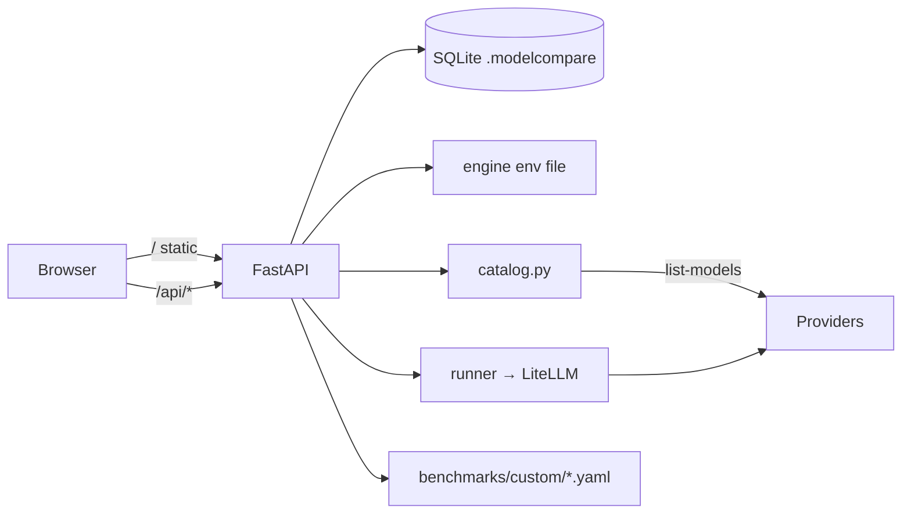

# MVP: Dashboard v2

## 1. Approval summary
**Problem and user:** You, comparing LLMs locally. Keys only live in the env file, models have to be typed into `targets.yaml`, there's no way to write custom benchmarks, and most comparisons end in "No measurable difference". Part of that is caused by errors being scored as 0 and by benchmarks that every model aces.

**MVP outcome:** From one local URL you can add keys, pick any chat model your keys can reach, build a custom project benchmark (with an AI draft), run it, and get a clear verdict: Better / Worse / Tie (+ the cheaper pick) / Incomplete / "add N cases".

**Architecture:**
- Frontend: Next.js App Router + TS + Recharts in `web/`, static export (`web/out`) served by FastAPI. `next dev` proxies to :8000 in development.
- Backend: the existing FastAPI/SQLite engine. The API moves under `/api` and the old paths stay as aliases.
- Keys: written to the engine env file (gitignored) with chmod 600, masked in the UI, localhost-only Host check.
- Look: inspired by artificialanalysis.ai, light theme, token-based so dark mode is a later swap. No copied brand assets.

**Milestones** (each one PR into `feat/dashboard-v2-redesign`, built, tested against the running app, merged, then the next)
| # | Plan | Milestone | Proves | Est. lines |
| --- | --- | --- | --- | --- |
| 1 | #1 | Trustworthy scores (backend) | errors excluded, `incomplete`/`equivalent` verdicts, saturation flag | ~300 |
| 2 | #2 | Next.js shell + design system | app served at one URL, nav, tokens, state components | ~350 |
| 3 | #3 | Port run → report → history | parity with old page; old page deleted | ~380 |
| 4 | #4 | Settings / keys | add/replace/remove key, masked, Host check | ~300 |
| 5 | #5 | Model catalog API | list-models per key, cached, runnable without YAML | ~350 |
| 6 | #6 | Models page | provider → model tree, select for run | ~300 |
| 7 | #7 | Compare + suggestions | ranked bars + CI, verdict matrix, Pareto, suggestions | ~400 |
| 8 | #8 | Projects API + AI draft | CRUD to `benchmarks/custom/`, draft endpoint | ~300 |
| 9 | #9 | Projects UI + end-to-end | editor, draft, save, run → Compare; E2E journeys | ~380 |

**End-to-end acceptance** (owned by m6b, proven in the headless browser, re-run on the feature-release PR)
- AC-9.5: Settings → add a fake key → masked → Models shows that provider's models (recorded fixture) → select a mock model → run → Compare shows verdict + suggestions.
- AC-9.6: Projects → describe + paste examples → Draft (mock model) → edit a case → save → run on two mock models → Compare.
- AC-9.7: Every page shows loading, empty and error states. Light theme screenshots of every page. UI audit 0 serious.

**Size** ~3,060 lines · ~3M tokens · 9 milestone PRs + 1 feature-release PR

**Risks:**
1. Writing to the env file from an HTTP endpoint: Host allowlist, provider var allowlist, atomic write, chmod 600, never echoed or logged. Tests and QA use the `MODELCOMPARE_KEYS_FILE` override and never touch the real file.
2. The score semantics change, so historical reports re-render with different numbers (intended).
3. Provider list-models APIs differ and change. Tests use recorded responses, and a provider that fails shows an error row instead of breaking the page.

**Out of scope for the MVP:** dark mode, harder/expanded standard deck, auth/multi-user, Postgres, CI.

---

## 2. Grill
Done in the previous session (draft `~/.claude/plans/create-a-plan-for-binary-hammock.md`). Rows 6–8 are lead decisions made while formalizing it. They are confirmed by approving this plan.

| # | Topic | Question | Answer |
| --- | --- | --- | --- |
| 1 | Data/auth | Where do keys live? | The engine env file (gitignored, already read by the CLI). The UI shows only `sk-…a1b2` and never returns a value |
| 2 | Core journey | How do models get selected? | Live provider list-models per key, chat-only, ~10 min cache, grouped by provider |
| 3 | Core journey | How are custom benchmarks authored? | A form editor plus an optional AI draft from pasted examples. You review it before it's saved to `benchmarks/custom/` |
| 4 | Stack | Frontend? | Next.js App Router + TS, static export served by FastAPI. One server in normal use |
| 5 | Quality bar | Look and feel? | Inspired by artificialanalysis.ai, light first, dense tables, horizontal ranked bars per provider color, top nav. No copied assets |
| 6 | Diagnosis | Why "No measurable difference"? | Errors counted as 0 (temperature unsupported, credit exhausted), ceiling effect, 12-case packs. Fix the data first (M1) |
| 7 | Scope | Milestone size | Draft M4 and M6 were each >400 lines, so each is split into API + UI (9 milestones) |
| 8 | Proof | How is QA isolated? | QA runs on :8765 with mock targets (`targets.qa.yaml`), `MODELCOMPARE_HOME=.modelcompare-qa`, and a keys-file override |
| 9 | Hosting | Environments? | Local only. No preview, no CI |

## 3. Product brief
- **Users and jobs:** a solo developer choosing between models for their own tasks, by quality, cost and speed.
- **Core journeys:** (1) configure keys → pick models → run → read verdict; (2) build a custom project benchmark → run → compare; (3) review history.
- **Non-goals:** multi-user, hosted deployment, dark mode, new standard deck cases.
- **Success signal:** comparisons end in Better/Worse/Tie/Incomplete with a next action, not "No measurable difference".

## 4. Architecture
### System

### Stack and why
| Layer | Choice | Why | Rejected |
| --- | --- | --- | --- |
| UI | Next.js App Router, TS, static export | Typed components and routing, one server at runtime | Vite SPA (fine, but the user chose Next); keeping vanilla HTML (doesn't scale to 4 pages) |
| Charts | Recharts | Bars, error bars and scatter out of the box | D3 (too low-level) |
| API | FastAPI (existing) | Already exposes every operation | Next API routes (would duplicate the engine) |
| Key store | Engine env file | The CLI already reads it, so nothing new to secure | OS keychain (cross-platform pain), DB (secrets in SQLite) |

### Data model
Unchanged tables `Run`, `Result`, `Job`, `CacheEntry`. `Result.error` is now excluded from scoring. Projects are YAML files validated by `schema.Benchmark`. Discovered models are synthesized `TargetConfig`s, and `targets.yaml` wins on a name clash.

### Conventions
Run: `cd engine && .venv/bin/modelcompare serve` (→ `.claude/project.json` app). Python tests: `engine/tests/`. Web: `web/` with `npm run lint && npm run build`. Browser checks: `.claude/qa/*.spec.ts`.

### ADRs
- `docs/context/decisions/2026-10-19-nextjs-static-export.md` (written in m2a)
- `docs/context/decisions/2026-10-19-keys-in-env-file.md` (written in m3)

## 5. Milestone plans
`.claude/plans/<1..9>-dashboard-v2-<phase>.md` (issues #1–#9, tracking #10).

## 6. Hand-off
