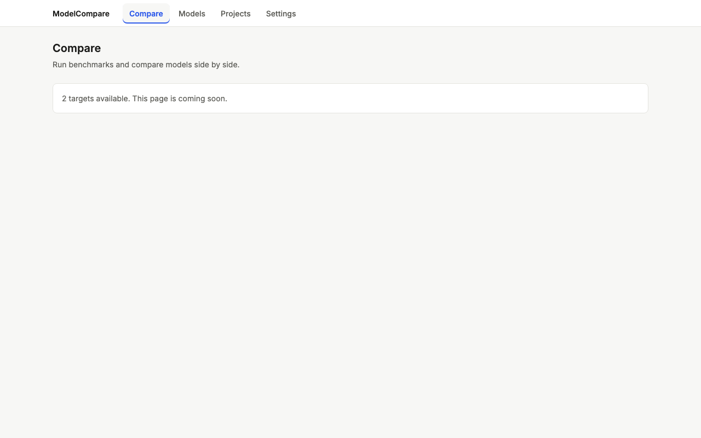
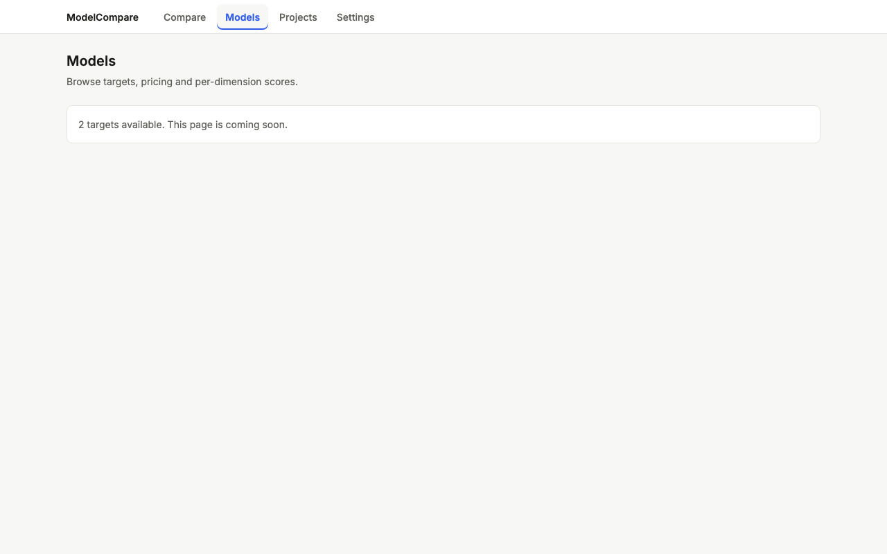
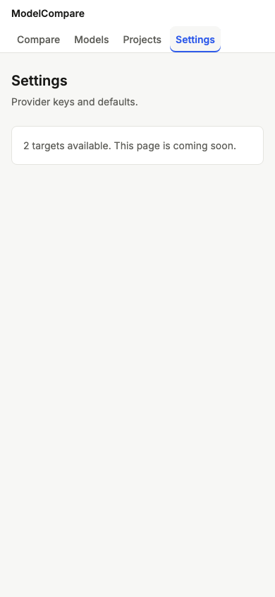
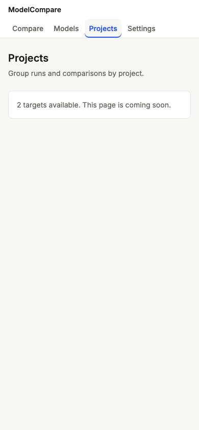

# Review: #2 Next.js shell and design system

> **Verdict:** Approve · **Merge risk:** Medium · **Read time:** ~12 min
> Plan: `.claude/plans/2-dashboard-v2-shell.md` · Evidence: `docs/evidence/2.json` · Autonomy: pr

## What and why
`modelcompare serve` now serves a new Next.js app at `/`, with a top nav (Compare · Models · Projects · Settings), light design tokens, and shared Loading, Empty and Error states on four placeholder pages. The API also answers under `/api`, and the old paths keep working. The single vanilla page couldn't carry four pages, and one server keeps `modelcompare serve` as the only command. Porting run → report → history is the next milestone.

## Design decisions
| Decision | Chosen | Instead of | Why |
| --- | --- | --- | --- |
| Runtime | Next static export (`web/out`) mounted by FastAPI | A Next server at runtime; Vite SPA | One process. Next was the user's choice (ADR `2026-10-19-nextjs-static-export.md`) |
| Routing | `APIRouter` included at `/api` and at `/` (alias, hidden from the schema). StaticFiles mounted last. `/api/{rest}` catch-all returns JSON 404 | Mounting the static files first | Old clients and the old page keep working. Unknown API paths no longer return HTML |
| Trailing slashes | `trailingSlash: true` (`compare/index.html`) | `compare.html` | Starlette's StaticFiles doesn't map `/compare` to `compare.html`. `GET /compare` now redirects (307) to `/compare/`, and `POST /compare` still reaches the API |
| Fallback | No `web/out` → `/` serves the old page | Failing to start | Safe rollback. The export is resolved from the checkout (`MODELCOMPARE_WEB_OUT` overrides it) and isn't packaged |
| Tooling | TypeScript 6.0.3, `prefetch={false}` on nav links | TypeScript 7; default prefetch | `eslint-config-next` rejects TypeScript 7. Prefetches showed up as failed requests in the audit |
| Tokens | Colours, type sizes, radii and topbar height on `:root`, `color-scheme: light`, provider colour tokens | Raw values | Dark mode becomes a token swap later |

## Proof — acceptance criteria
| Criterion | Proven by | Result |
| --- | --- | --- |
| AC-2.1 `/` serves the Next app; `GET /api/targets` returns the same JSON as `GET /targets` | `engine/tests/test_api.py:106`, `:118` (GET/POST `/compare` coexist); `.claude/qa/shell.spec.ts:31` (browser) | ✔ |
| AC-2.2 every page shows the nav with the active item, light tokens, a 16px gutter at 390px, no horizontal scroll | `.claude/qa/shell.spec.ts:14` (5 routes × 1280 and 390, browser) | ✔ |
| AC-2.3 placeholder pages render the shared Loading, Empty and Error states (Error when the API is down) | `.claude/qa/shell.spec.ts:40`, `:50`, `:56` (browser, routes intercepted) | ✔ |
| AC-2.4 no `web/out` → `/` serves the old page | `engine/tests/test_api.py:112` (asserts a marker only the old page has) | ✔ |

Also tested: unknown `/api` paths return JSON 404 (`engine/tests/test_api.py:134`, `:140`).

Ran against: the local app at http://127.0.0.1:8765 on commit `246113d`. 790 pytest tests pass, `npm run lint` and `npm run build` pass, API smoke passes, and the headless Playwright checks pass. UI audit: 0 serious, 0 minor (5 pages × 320/390/768/1280). Diff coverage was not measured (no `coverage.command`).

## Screens
| Screen | Before | After |
| --- | --- | --- |
| Compare, 1280 | old single page |  |
| Models, 1280 (active nav cue) | — |  |
| Settings, 390 | — |  |
| Projects, 390 | — |  |

## Risks and findings
Reviewer agent: **Approve**, no High findings. All findings were fixed before this PR opened:
| Sev | Where | Finding | Status |
| --- | --- | --- | --- |
| Medium | `api.py` mount | Unknown `/api` paths returned the Next 404 HTML, or 405 on POST | Fixed: JSON 404 catch-all, tested |
| Medium | `test_api.py` fixture | The old-page test passed against the Next app whenever `web/out` was built | Fixed: fixture uses `create_app(<no export>)` plus an old-page marker |
| Medium | `globals.css` nav | The active item was marked by colour only (WCAG 1.4.1) | Fixed: weight 600 plus a bottom accent bar |
| Low | `api.py` | `MODELCOMPARE_WEB_OUT` undocumented; export not packaged | Fixed: README plus a code comment |
| Low | ADR | Root aliases could shadow future pages without a trailing slash | Recorded in ADR consequences |
| Low | `ApiPage.tsx`, `States.tsx`, `globals.css` | Literal backticks, `Error` shadowing the global, raw sizes | Fixed |
| Low | `.claude/design-review/` | QA artifact with absolute paths was tracked | Fixed: gitignored |

Risk: on this feature branch, `/` shows placeholders until milestone 3 ports the run/report flow. The old page is still reachable only when `web/out` is absent.

## Review path
Read in this order, riskiest first:
1. `engine/modelcompare/api.py`, `create_app`: router, aliases, catch-all, mount order, fallback (~5 min)
2. `engine/tests/test_api.py`, new tests and the fixture (~2 min)
3. `web/next.config.ts` and the ADR (~2 min)
4. `web/components/{Nav,States,ApiPage}.tsx`, `web/app/globals.css` (~3 min)

Skip: `web/package-lock.json`, `.claude/qa/*`, `web/app/icon.svg`.

## How to test for humans

Where: Not on develop yet
Who: the plan doesn't name an account (local, single user)
About 5 minutes. The automated checks passed. This is what a person can judge that those checks do not.

### Shell

1. Build the web app once (`cd web && npm ci && npm run build`), then run `modelcompare serve` and open http://127.0.0.1:8000/
2. You should see the ModelCompare top nav with Compare highlighted (blue, bold, underlined) and a card saying how many targets are configured.
3. Click Models, Projects, then Settings.
4. You should see the highlight move to each item, and every page shows the same nav and card.
   - Watch for: the font. It should be Inter. A system font means the Google Fonts fetch failed during the build.
5. Narrow the browser to phone width (about 390px).
6. You should see the nav fit on one row under the brand, a 16px margin each side, and no sideways scrolling.
7. Stop `modelcompare serve` and click "Try again" on any page.
8. You should see the error card ("The ModelCompare API is not reachable…"), not a blank page.

### Nearby: should be unchanged

- CLI: `modelcompare run …` and the HTML report export work as before.
- Old API paths: http://127.0.0.1:8000/targets still returns JSON.

### Not covered by the checks

- `next dev` with the `/api` proxy to :8000 was not run, only `next build`. Running `cd web && npx next dev` while `modelcompare serve` runs on :8000 would confirm it.
- A build with no network fails on the Inter font fetch.

## Check yourself
- [ ] `pip install .` (non-editable) doesn't include `web/out`, so `/` falls back to the old page unless `MODELCOMPARE_WEB_OUT` is set.
- [ ] The "dark" audit screenshots show the light theme (no dark mode yet, by plan).
- [ ] Recharts is installed but unused until the Compare milestone.
