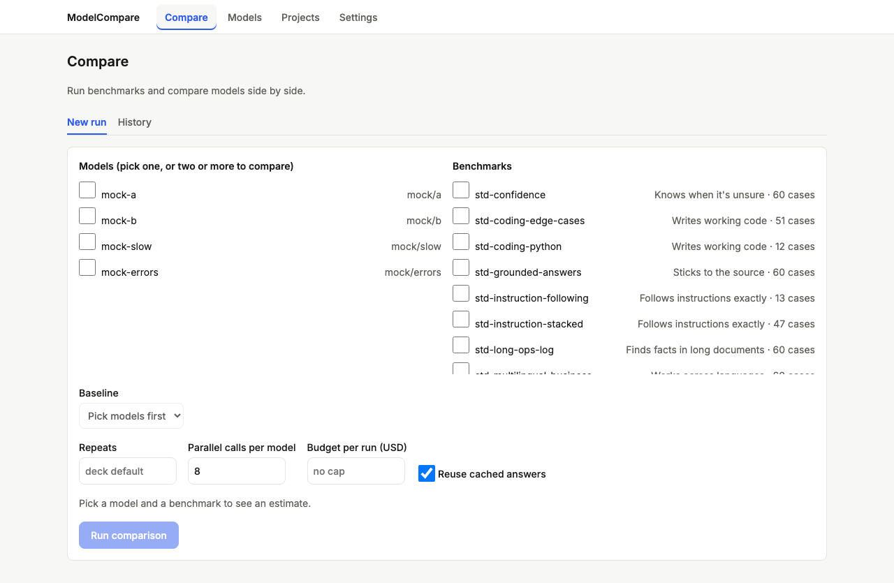
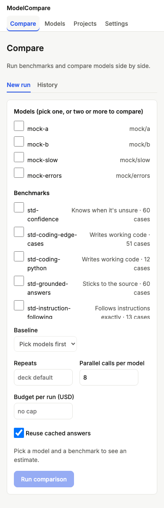
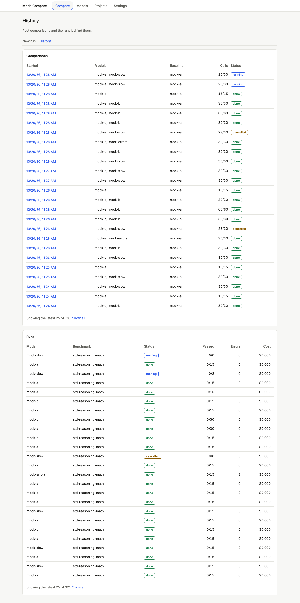
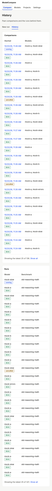

# Review: #3 Port run, report and history to Next.js

> **Verdict:** Approve · **Merge risk:** Medium · **Read time:** ~20 min
> Plan: `.claude/plans/3-dashboard-v2-port.md` · Evidence: `docs/evidence/3.json` · Autonomy: pr

Ships as four stacked PRs into `feat/dashboard-v2-redesign`, each ≤400 counted lines (see the plan's PR split):
| Part | Branch | Content | Counted lines |
| --- | --- | --- | --- |
| 3a | `feat/dashboard-v2-redesign-p3a-compare` | run form, progress, cancel, report table | 399 |
| 3b | `feat/dashboard-v2-redesign-p3b-history` | history page, New run · History tabs, nav | 127 |
| 3c | `feat/dashboard-v2-redesign-p3c-parity` | budget + cost confirmation, run options, key status, judge pick, one-model scorecard, case explorer, report links | 139 |
| 3d | `feat/dashboard-v2-redesign-p3d-cleanup` | delete the old page, 503 without a web build, docs | 397 (mostly the 375-line deletion) |

The full QA gate (every AC-3.x) runs on the top of the stack, 3d. On 3a–3c the AC step correctly reports the criteria owned by later parts as missing.

## What and why
Everything the old single-page dashboard did now works in the Next app: pick models and benchmarks, see an estimate, confirm the cost, run, watch progress, cancel, read the report and each case, and browse history. The old page is then deleted so the two UIs can't drift. Charts, the verdict matrix and suggestions come in a later milestone.

## Design decisions
| Decision | Chosen | Instead of | Why |
| --- | --- | --- | --- |
| Split | Four stacked PRs | One 880-line PR | PR-size rule. Same scope |
| History route | `/history/?job=<id>` | `/history/[id]` | Static export can't do dynamic segments |
| Nav | Four nav items. Compare covers "New run · History" sub-tabs | A fifth nav item | Matches the MVP's nav |
| Cost gate | Inline "may cost up to $X · Confirm and run / Back" step | `window.confirm` | Dialogs block headless checks. A paid run always needs a second, separate submit |
| Keys | Models without a key are shown disabled with "no key (VAR)" | Hiding them (old page) | Tells the user why a model isn't selectable |
| Polling | 1 s poll; after the first load, a failed poll shows "Reconnecting…" with backoff up to 15 s. A 409 on Cancel refreshes | Error-replacing the job | A network blip shouldn't hide a running job |
| Benchmarks | Flat checkbox list | Per-dimension picker | Simpler. The dimension is shown next to each item |
| Missing `web/out` | 503 "Run: cd web && npm ci && npm run build" | Old page fallback | The old page is gone. ADR amended (dated) |
| Naming | `JobView` | `JobProgress` (plan) | It shows progress and then the report |

## Proof — acceptance criteria
| Criterion | Proven by | Result |
| --- | --- | --- |
| AC-3.1 two mock models + a benchmark → estimate → Run → progress updates → report verdicts incl. `equivalent`/`incomplete` | `.claude/qa/run-flow.spec.ts:8` (progress rises before done), `:41` (incomplete), `:28` (unknown verdict), `:118` (options, cost confirmation), `:146` (no-key), `:172` (one-model scorecard), `:181` (judge required) | ✔ |
| AC-3.2 Cancel stops a running job and shows cancelled | `run-flow.spec.ts:50`, `:217` (409 race) | ✔ |
| AC-3.3 past jobs are listed and open their report | `run-flow.spec.ts:60`, `:107` (cap + show all), `:157` (case explorer, HTML/JSON links) | ✔ |
| AC-3.4 `index.html` deleted and `/` serves the Next app | `engine/tests/test_api.py:115`, `:108` (503 message), via `.claude/qa/ac-pytest.test.mjs` | ✔ |
| AC-3.5 loading while polling, empty history, error when the API fails | `run-flow.spec.ts:72`, `:82`, `:91`, `:101`, `:204` (reconnecting) | ✔ |

All are browser checks except AC-3.4 (pytest). Ran against the local app at http://127.0.0.1:8765 (mock targets) on commit `29f0a60`. 790 pytest tests pass, 33 browser tests pass, web lint and build pass. UI audit: 0 serious, 0 minor. Diff coverage was not measured (no `coverage.command`).

## Screens
| Screen | Before | After |
| --- | --- | --- |
| Compare, 1280 | old page |  |
| Compare, 390 | — |  |
| History, 1280 | — |  |
| History, 390 | — |  |

## Risks and findings
The reviewer agent ran twice. Round 1 requested changes (2 High, 10 Medium, 3 Low); round 2 approved (0 High, 5 Medium, 5 Low). Everything below was fixed before these PRs opened unless marked otherwise.
| Sev | Where | Finding | Status |
| --- | --- | --- | --- |
| High | old page deletion | Parity gaps: budget, cost confirmation, run options, key status, judge pick, case explorer, report links | Fixed in 3c |
| High | QA gate | The AC step checked the wrong plan (split branch names unknown) | Fixed: PR split table in the plan |
| Medium | `RunForm` | Stale estimate; Run enabled without a needed judge; budget 0 treated as "no cap"; one-model scorecard dropped | Fixed |
| Medium | `JobView` | Alert re-announced every poll; a failed poll hid the job; Cancel 409 race | Fixed |
| Medium | `ReportTable` | `mixed` unstyled; unknown verdicts invisible | Fixed |
| Medium | `HistoryView` | Unbounded jobs list; broken at 390px | Fixed |
| Medium | `CaseExplorer` | No header; unsorted | Fixed |
| Medium | `ac-pytest.test.mjs` | Bridge tests ✖ under the QA harness (path) | Fixed: resolved from the git root |
| Medium | ADR | Accepted decision reworded in place | Fixed: dated amendment |
| Low | various | Tokens, `key={job}`, `aria-labelledby`, cent budgets, `usd()` formatting, missing tests | Fixed |
| Low | `engine/modelcompare/api.py` `RunRequest` | No bounds: `concurrency: 0` from an API client hangs a job | **Open: follow-up** (not in this diff; the UI enforces `min`) |

## Review path
Read in this order, riskiest first:
1. `web/components/RunForm.tsx`: cost gate, estimate, request body, judge (~8 min)
2. `web/components/JobView.tsx`: polling, backoff, cancel (~5 min)
3. `engine/modelcompare/api.py`: 503 without a build; the old page is gone (~2 min)
4. `web/components/ReportTable.tsx`, `CaseExplorer.tsx` (~3 min)
5. `web/components/HistoryView.tsx`, `SectionTabs.tsx`, `Nav.tsx` (~2 min)

Skip: `engine/modelcompare/web/index.html` (deleted), `.claude/qa/*`, `engine/targets.qa.yaml`.

## How to test for humans

Where: Not on develop yet
Who: the plan doesn't name an account (local, single user)
About 8 minutes. The automated checks passed. This is what a person can judge that those checks do not.

### Run a comparison

1. Build and start: `cd web && npm ci && npm run build`, then `modelcompare serve`, and open http://127.0.0.1:8000/
2. Tick two models you have keys for and one small benchmark.
3. You should see an estimate (calls and cost), and models without a key greyed out with "no key".
4. Set "Budget per run" to a small amount and click Run comparison.
5. You should see "may cost up to $X · Confirm and run / Back" before anything is spent. Confirm.
6. You should see the progress bar move, then a report table with verdict chips (Better, Worse, Equivalent, Incomplete…), and error reasons if a provider failed.
   - Watch for: a cost figure that looks wrong next to your provider's pricing.
7. Click "View cases" on a run.
8. You should see each case's output, score and reason, sorted by case.

### Cancel and history

1. Start a longer run and click Cancel. You should see the status change to cancelled.
2. Open the History tab. You should see your runs (latest 25, "Show all" for the rest). Click one to see its report and its "Open report" and JSON links.

### Nearby: should be unchanged

- `modelcompare run …` from the CLI, and its HTML report.
- API clients on the old paths (for example `/targets`) still get JSON.

### Not covered by the checks

- Real spend and real judge selection. The browser checks mock costs and judges, because mock targets are free and can't judge.
- Running without a web build now shows a 503 with the build command instead of the old page.

## Check yourself
- [ ] Follow-up: bound `RunRequest` (`concurrency ≥ 1`, `repeats ≥ 1`, `budget_usd ≥ 0`) for API clients.
- [ ] Run is disabled until an estimate for the current form arrives, so quick clicks wait for it.
- [ ] The QA bridge resolves the repo via `PWD`/`cwd`. A runner that clears both falls back to the spec's folder.
