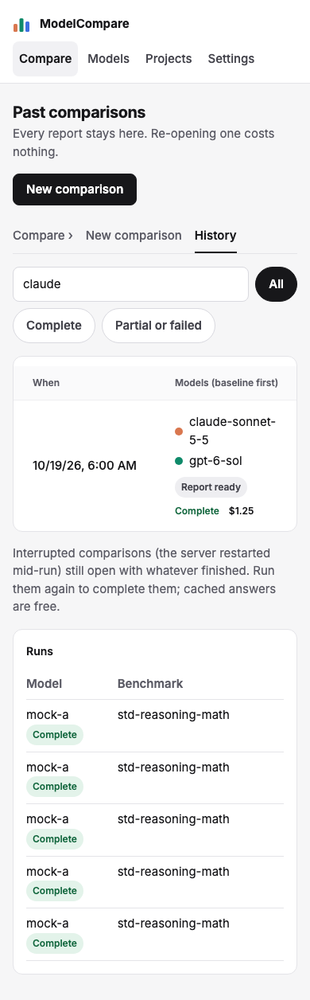
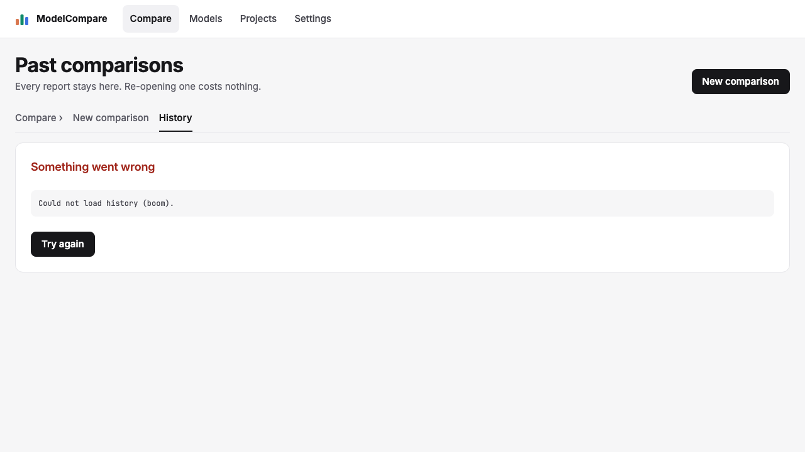
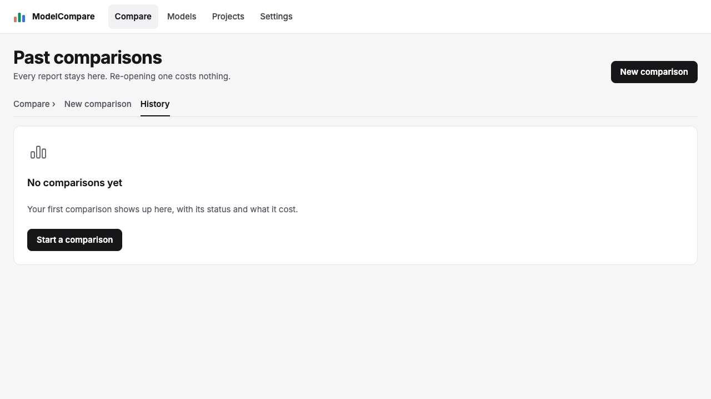
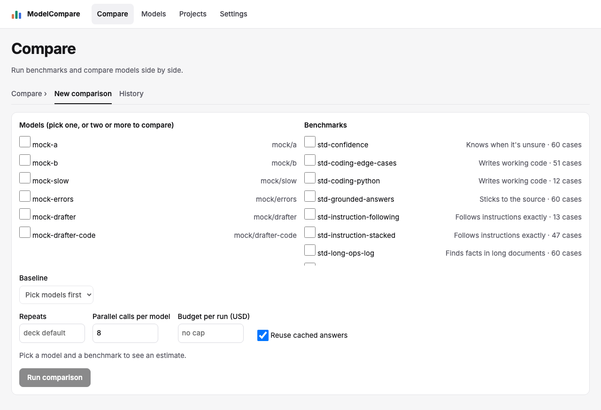
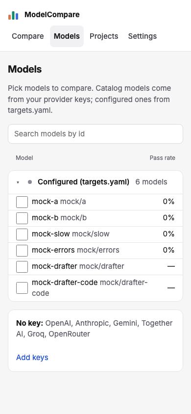

# Review: #34 Concept UI redesign — milestone 1: shell, tokens, states, History

> **Verdict:** Approve · **Merge risk:** Low · **Read time:** ~8 min
> Plan: `.claude/plans/34-concept-ui-redesign.md` (row p1) · Evidence: `docs/evidence/34.json` · Autonomy: pr (squashes into `feat/concept-ui-redesign`)

## What and why
Every page gets the concept's colours, type and top bar. History becomes "Past comparisons": filter chips, a search box, and one row per comparison with its models, outcome, spend and status, and the row opens the report. The loading, empty and error-with-retry panels from the States board are now the shared versions, which later milestones reuse for Projects, Settings and the report. This is the foundation milestone 1 of 6. The other pages only pick up the new tokens for now.

## Design decisions
| Decision | Chosen | Instead of | Why |
| --- | --- | --- | --- |
| Styling | Our own CSS tokens on `:root` (ADR `docs/context/decisions/2026-10-21-ui-tokens-restyle.md`) | Tailwind or a UI kit | No new dependency and no rewrite of existing markup. Dark mode can come later as a token override |
| History outcome | "Report ready", "Partial report" or "No report", from the job status | The board's "Switch to X / Keep X" | `/jobs` carries no report data. Showing the verdict would need a report fetch per row |
| History spend | Sum of `/runs` cost over each job's `run_ids` | A per-job cost field | `/jobs` has none. `/runs` returns every run when no limit is passed, so the sum is complete |
| "Partial or failed" filter | Interrupted, cancelled and failed only | Everything not done | Running and queued comparisons aren't partial yet (lead fix e48066b) |
| Phones | Outcome, status and spend stacked under the models in each row | Horizontal table scroll | At 390 px the table hid all three (review High, fixed in 798a2a6) |
| Row click | A stretched link from the date cell, named "date, models, outcome" for screen readers, with a row focus ring | A `tr` onClick | Keeps a real link (middle-click and keyboard work) |
| Runs table | Kept below, restyled | Removing it | Comparisons started from the CLI stay visible |
| Plan Screens list (lead edit) | The Report screen points at the seeded `qa-every-verdict` job; the Run screen comes from the spec's mocked running job | `<running>` and `<done>` placeholders | The UI audit requested the placeholders as literal job ids and reported two false 404s |

## Proof — acceptance criteria
| Criterion | Proven by | Result |
| --- | --- | --- |
| AC-34.1 new top bar on every page, new tokens, no horizontal scroll at 390 px | `.claude/qa/concept-ui.spec.ts:24` (5 routes × 1280 and 390: four nav links, one `aria-current`, `--ink` token, `scrollWidth`), `:112` (screenshots) | ✔ |
| AC-34.12 History lists models, outcome, spend and status; filter chips work; a row opens its report | `concept-ui.spec.ts:37` (columns, the Complete and Partial-or-failed filters including running excluded, search, outcome, status and spend inside the viewport at 390), `:74` (row → `/compare/?job=`) | ✔ |
| AC-34.15 (History's share) loading, empty, error-with-retry | `concept-ui.spec.ts:83` (mocked 500 → error, then Retry refetches), `:102` (empty panel with a next step) | ✔ |

The other criteria (AC-34.2–11, .13, .14, .16) belong to milestones 2–6 and are reported uncovered on purpose. Ran against the local app at http://127.0.0.1:8765 (mock targets, isolated data) on commit `798a2a6`: verify passed (pytest, lint, build), API smoke passed, browser 171 of 171, UI audit 0 serious and 10 minor. Diff coverage isn't measured (`coverage.command` is null).

## Screens
| Screen | After |
| --- | --- |
| History, 1280 |  |
| History, 390 |  |
| History, error |  |
| History, empty |  |
| Compare (tokens only), 1280 |  |
| Models (tokens only), 390 |  |

## Risks and findings
Reviewer agent findings (High = blocking, fixed before this PR opened; Medium = recommended):
| Sev | Where | Finding | Status |
| --- | --- | --- | --- |
| High | `web/components/HistoryView.tsx` | At 390 px, outcome, spend and status were hidden | Fixed (798a2a6), asserted at 390 |
| Medium | `HistoryView.tsx` | The row link was named by its date only | Fixed: adds models and outcome as screen-reader text |
| Medium | `web/app/globals.css` | No visible focus on the row; the overlay relies on `position: relative` on `tr` | Focus ring fixed. Tested in Chromium only, not WebKit or Firefox |
| Medium | `HistoryView.tsx` | Runs but no comparisons showed "No comparisons match" | Fixed: shows the empty panel unless a filter or search is active |
| Medium | `globals.css` | Hard-coded button and chip sizes | Fixed: `--btn-h` and the spacing tokens |
| Medium | plan Screens list | Edited after approval | Lead edit to the audit targets only; scope unchanged (see Design decisions) |
| Low | spec, spend format, skeleton token, error hint | Missing running/interrupted fixtures, 3-decimal spend, borrowed `--bar-h`, hint in the monospace block | All fixed |
| Low | `HistoryView.tsx` empty copy | Says "with its status"; the board says "with its recommendation" | Open: the list has no recommendation to show |

Minor UI-audit findings (10): `sr-only` text reported as clipped (expected for visually hidden text) on History and Models, and a pre-existing tap-target on the project editor error link (milestone 5).

## Review path
Read in this order, riskiest first:
1. `web/app/globals.css`: the tokens and primitives every later milestone uses; check that the unredesigned pages still look sane (~8 min)
2. `web/components/HistoryView.tsx`: filter, search, spend and the phone layout (~6 min)
3. `.claude/qa/concept-ui.spec.ts`, then the selector and copy edits in `run-flow`, `e2e` and `shell` specs (~5 min)
4. `web/components/States.tsx`, `SectionTabs.tsx`, `ui/VerdictChip.tsx`, `ui/BarList.tsx`, `web/lib/vendor.ts` (~4 min)
5. `web/components/Nav.tsx`, `web/app/layout.tsx`, the ADR (~2 min)

Skip: screenshots under `docs/reviews/34-p1/`.

## How to test for humans

Where: Not on develop yet
Who: the plan doesn't name an account. The app has no login.
About 6 minutes. The automated checks passed. This is what a person can judge that those checks don't.

### Top bar and look

1. Open /compare/, then /models/, /projects/ and /settings/
2. You should see the new top bar (coloured bar mark, Compare, Models, Projects, Settings) with the current page highlighted, on a light grey canvas
   - Watch for: Projects, Settings and Compare aren't redesigned yet. They should look like before in the new colours, not broken.

### History

3. Open /history/
4. You should see "Past comparisons", Compare › New comparison / History tabs, a search box, the All, Complete and Partial or failed chips, and a table with When, Models, Tested, Outcome, Spend and Status
5. Click "Partial or failed", then "Complete", then type a model name in the search box
6. You should see the rows narrow each time. A comparison still running appears only under All.
7. Click a row
8. You should land on that comparison's report at /compare/?job=…
9. Narrow the window to phone width
10. You should still see each row's outcome, status and spend under its models, with no sideways scroll

### Nearby — should be unchanged

- Compare: start a comparison on two models → the form and progress work as before
- Models: tick two models → "Compare selected" still opens Compare with them chosen

### Not covered by the checks

- The row click uses a stretched link and is tested in Chromium only; try it once in Safari
- History spend is $0.00 for mock targets; check a real paid comparison shows its cost

## Check yourself
- [ ] Body text is now 15px and the content is up to 1280px wide; every page inherits this
- [ ] The empty-state copy ("with its status" vs the board's "with its recommendation") is acceptable
- [ ] `BarList` and `VerdictChip` are unused outside History until milestones 3–4
