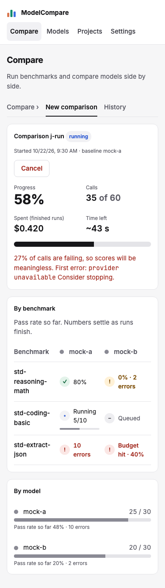

# Review: #34 Concept UI redesign — milestone 2: Choose and Run

> **Verdict:** Approve · **Merge risk:** Medium · **Read time:** ~10 min
> Plan: `.claude/plans/34-concept-ui-redesign.md` (row p2) · Evidence: `docs/evidence/34.json` · Autonomy: pr (squashes into `feat/concept-ui-redesign`)

## What and why
Compare's two working screens now match the concept.
- **Choose (`/compare/`):** model cards with key status and a baseline marker, use-case presets, one toggle per dimension, and a sticky "Before you run" panel with cost, time, calls and cached share.
- **Run (`/compare/?job=…`):** overall percent, calls, spend and time left; progress per model; and a benchmark × model grid with done, running, queued, warning and error cells.

Every fetch, poll and request is unchanged; only the layout moved.

## Design decisions
| Decision | Chosen | Instead of | Why |
| --- | --- | --- | --- |
| One-model runs | Start is disabled only with no model. One model runs as a scorecard, with a note | Disabling below two models (the original AC-34.3) | It conflicted with the existing scorecard journey. The user chose to keep the scorecard (plan Grill 5, AC-34.3 amended) |
| What to test | One toggle per dimension, with a mixed state; per-benchmark checkboxes under "Choose individual benchmarks" | One tile per benchmark | AC-34.3 and the board say dimensions (about 10 tiles, not 24). The disclosure opens on its own when a link preselects benchmarks |
| Run grid rows | Benchmarks | Dimensions | AC-34.4 says benchmark × model, and that's what the job data has |
| Grid cell states | A stopped run (budget hit, cancelled, failed) shows as an error. A minority of errors shows "pct · N errors" as a warning; mostly errors shows as an error | Any finished run as done; any error hides the score | Review Medium: a partial run looked complete |
| Spend | "Spent (finished runs)" | "Spent" | The job's live progress has no cost and the plan allows no API change |
| Time left | Estimated in the browser from elapsed time and call progress | A server estimate | No API change |
| Button names | "Run comparison", "Cancel" | The board's "Start comparison", "Cancel run" | Existing journeys depend on these names |
| Dropped | The input/output token cost split; the live per-case feed | — | No data for either (plan Concerns) |

## Proof — acceptance criteria
| Criterion | Proven by | Result |
| --- | --- | --- |
| AC-34.2 cards show key status, a missing-key model can't be picked, one selected model is baseline | `.claude/qa/concept-ui.spec.ts:144` (missing-key card disabled and linked to Settings; "Make baseline" moves the marker) | ✔ |
| AC-34.3 (amended) presets and dimension toggles update a sticky estimate; Start disabled with no model and says why; one model shows the scorecard note | `concept-ui.spec.ts:161` (a dimension toggle checks its benchmarks and changes cases and estimate, $1.23 shown, sticky at 1280, presets, reason via aria-describedby, one-model note); `run-flow.spec.ts` one-model scorecard journey restored | ✔ |
| AC-34.4 running job: percent, calls, spend, time left, per-model progress, grid states; Cancel works | `concept-ui.spec.ts:218` (mocked job with done, running, queued, warning, error and budget-hit cells; Cancel ends it); `run-flow.spec.ts` live run and cancel journeys | ✔ |

Ran against the local app at http://127.0.0.1:8765 (mock targets, isolated data) on commit `c242fff`: verify passed, API smoke passed, browser 174 of 174, UI audit 0 serious and 10 minor (the same as milestone 1, none on Choose or Run). Diff coverage isn't measured. Milestones 3–6 criteria are uncovered on purpose.

## Screens
| Screen | After |
| --- | --- |
| Choose, 1280 |  |
| Choose, 390 |  |
| Run, 1280 (mocked job with errors, so the failing-calls banner shows) |  |
| Run, 390 |  |

## Risks and findings
Reviewer agent findings (High = blocking, fixed before this PR opened; Medium = recommended):
| Sev | Where | Finding | Status |
| --- | --- | --- | --- |
| High | `web/components/RunForm.tsx` | Benchmark toggles instead of the dimension toggles AC-34.3 asks for | Fixed (6bbeede) |
| Medium | `web/components/JobView.tsx` | Runs that stopped early showed as done | Fixed |
| Medium | `JobView.tsx` | One error hid the pass rate | Fixed: warning state |
| Medium | `JobView.tsx` | "Spent" understates while runs are in flight | Relabelled "Spent (finished runs)" |
| Medium | `RunForm.tsx` | Board copy missing (under-10-cases warning, budget line, option hints) | Fixed |
| Low | RunForm, JobView, ModelPicker, CSS, spec | Duplicate or missing disabled reasons; grid hidden until the first call; grid cut off at 390; baseline not announced; estimate cost and sticky untested; accent-blue progress bar | All fixed |

Spec edits to existing journeys: "Estimate: N calls" text became the `est-calls` value (same number checked). The progress table header became the "By benchmark" region (same show/hide check). Specs that tick a benchmark by name now open "Choose individual benchmarks" first. No assertion was dropped.

## Review path
Read in this order, riskiest first:
1. `web/components/RunForm.tsx`: dimension toggles, the disabled reason, baseline, and the estimate wiring (~12 min)
2. `web/components/JobView.tsx`: cell states, time left, spend, grid gating (~10 min)
3. `.claude/qa/concept-ui.spec.ts:144-260`, then the edits in `run-flow`, `models`, `judge`, `e2e` and `compare` specs (~6 min)
4. `web/components/ModelPicker.tsx` (`ModelCard`) and `web/app/globals.css` (~5 min)

Skip: screenshots under `docs/reviews/34-p2/`.

## How to test for humans

Where: Not on develop yet
Who: the plan doesn't name an account. The app has no login.
About 7 minutes. The automated checks passed. This is what a person can judge that those checks don't.

### Choose

1. Open /compare/
2. You should see model cards with a key status line. A model whose provider has no key is greyed out and links to Settings.
3. Tick two models, then click "Make baseline" on the second
4. You should see the Baseline marker move to that model, in the card and in "Before you run"
5. Click a use-case preset, then toggle a dimension on and off
6. You should see the dimension tiles change, and the cases count and estimate (cost, time, calls, cached) update in the sticky panel
   - Watch for: open "Choose individual benchmarks". Ticking a single benchmark should leave its dimension in a mixed state.
7. Untick every model
8. You should see "Run comparison" disabled, with the reason under the estimate. Tick one model: Run is enabled and the note says one model gives a scorecard.

### Run

9. Tick two mock models and one dimension, then click "Run comparison"
10. You should see percent, calls, spend (finished runs) and time left, a bar per model, and the By benchmark grid filling in from queued to running to done
11. Start another run and click Cancel
12. You should see it stop and open whatever finished

### Nearby — should be unchanged

- Models: tick two models, then "Compare selected" → Choose opens with them ticked
- Projects: run a project on two models → the run starts and opens its comparison
- History: a finished comparison row → opens the existing report (the report is redesigned in milestones 3–4)

### Not covered by the checks

- Time left is estimated in the browser. Check that it looks sensible on a real, slower run.
- With more than two models, the grid scrolls sideways inside its card on a phone.

## Check yourself
- [ ] "Spent (finished runs)" stays at $0 during the first benchmark of a real run. Is the label clear enough?
- [ ] The one-model note keeps the old lowercase wording, because the restored test matches it
- [ ] The Run screen still sits under the "New comparison" tab, as milestone 1 left it
