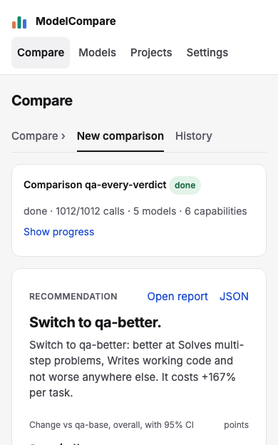
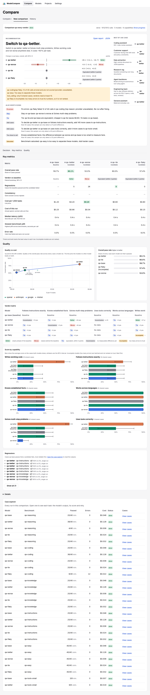

# Review: #34 Concept UI redesign — milestone 3: report top (decision, key metrics, quality)

> **Verdict:** Approve · **Merge risk:** Medium · **Read time:** ~10 min
> Plan: `.claude/plans/34-concept-ui-redesign.md` (row p3) · Evidence: `docs/evidence/34.json` · Autonomy: pr (squashes into `feat/concept-ui-redesign`)

## What and why
A finished comparison now opens on the decision instead of tables. It shows:
- a headline recommendation;
- each candidate's overall change against the baseline with its 95% range and verdict;
- the best model per use case;
- the caveats.

Then come a Key metrics table (nine metrics per model, best value highlighted) and Quality: the quality vs cost scatter with its Pareto line, next to sorted pass-rate bars.

The older sections below (ranked bars, verdict matrix, regressions, details) stay until milestone 4 replaces them. The report data and every request are unchanged.

## Design decisions
| Decision | Chosen | Instead of | Why |
| --- | --- | --- | --- |
| Headline | Ranked: the switch with the largest overall gain, else trade-off, else tie; "Stay" only when every candidate says stay | The first decision the engine lists | The engine lists decisions in pick order, so the headline changed with the order you ticked models (review High) |
| Regressions row | `summary.markers[model].regressions` (0 for clean candidates) | Counting `flagged` entries | Candidates with no regressions have no `flagged` entry and showed "—" (review High) |
| Decision first | A finished job shows one summary line ("Show progress" restores the stats); "Open report" and "JSON" move into the Recommendation header; the Compare lede hides when a job is open | The Run stats card and a separate report card above the decision | The decision started about 540 px down. It's now under 300 px at 1280 and the change rows are on the first screen at 390 |
| Overall change for incomplete or insufficient data | "Not compared", with no bar | Drawing the engine's 0 [0, 0] | It would read as a measured zero |
| Latency | p50 from `markers.latency_p50`; "Slowest benchmark p95" = max across benchmarks, skipping benchmarks where every call errored | A call-weighted mean of p95s | Matches the engine's convention. An average understates the tail (review Medium) |
| Run cost | Shown with the hint "Actual spend; cached calls are free", never highlighted | Highlighted as cheapest | Cached calls cost $0, so a cache hit would "win" (review Medium). Cost per 1k ranks price |
| Best by use case | First non-incomplete model in each profile ranking; hidden with one model | `ranking[0]` | Could name an incomplete model the caveat says isn't ranked. Filters only; no tie recomputation (plan Concern) |
| Key metrics highlight | No highlight when values tie across all models or fewer than two values exist; incomplete models never win; ties all highlighted | Always highlight one cell | Seeded latency is identical for every model, and a highlight there would be noise |
| Suggestions panel | Folded into the Recommendation ("Also worth doing"); the old `Suggestions.tsx` file stays unused until milestone 4 deletes it | Deleting it here | Keeps this PR at 386 counted lines; the plan schedules the deletion for milestone 4 |
| Scatter | `QualityScatter` with an `x` of cost or latency; only cost renders here | A second scatter component | Milestone 4 adds the latency view |
| Not built | Board's per-model header cards, "Add a model" tile, "Statistically ahead" note, scroll-spy on section tabs | — | Not in this milestone's criteria, or no data source |

## Proof — acceptance criteria
| Criterion | Proven by | Result |
| --- | --- | --- |
| AC-34.5 the report opens with the recommendation, each candidate's overall change with its 95% CI against zero and its verdict, then best per use case and caveats | `.claude/qa/concept-ui.spec.ts:255` (seeded `qa-every-verdict`; incomplete and all-errors jobs), `:349` (reversed suggestion order keeps "Switch to qa-better."), `:357` (rows on the first screen at 390 px; top under 300 px at 1280) | ✔ |
| AC-34.6 one table of nine metrics per model with the best value per row highlighted | `concept-ui.spec.ts:295` (9 rows; one highlight on pass rate and cost per 1k; a 0-regression candidate highlighted; no highlight on run cost, tied latency or consistency) | ✔ |
| AC-34.7 quality vs cost scatter keeps the Pareto line and explanation, next to sorted pass-rate bars | `concept-ui.spec.ts:324`; `compare.spec.ts` AC-7.3 (incomplete model never on the front) | ✔ |

Existing specs: in `compare.spec.ts` and `e2e.spec.ts`, the region "Suggestions" was renamed to "Recommendation". AC-7.4 (errors first in the list) and AC-7.5 (decision first on screen) still pass. No assertion was dropped.

Ran against the local app at http://127.0.0.1:8765 (mock targets, seeded reports, isolated data) on commit `fbde510`: verify passed, API smoke passed, browser 183 of 183, UI audit 0 serious and 10 minor (the same as earlier milestones; none on the report). Diff coverage isn't measured. AC-34.8–.11, .13, .14 and .16 belong to milestones 4–6.

## Screens
| Screen | After |
| --- | --- |
| Report top, 1280 |  |
| Report top, 390 |  |
| Full report, 1280 (old lower sections still below until milestone 4) |  |

## Risks and findings
Reviewer agent findings (High = blocking, fixed before this PR opened; Medium = recommended):
| Sev | Where | Finding | Status |
| --- | --- | --- | --- |
| High | `web/components/DecisionPanel.tsx` | Headline depended on target order | Fixed (41a909e), test reverses the order |
| High | `web/components/ReportTable.tsx` | 0-regression candidate showed "—" | Fixed, test asserts 0 and highlight |
| Medium | `JobView.tsx`, `ReportTable.tsx` | Finished-job header pushed the decision down | Fixed, tighter spec |
| Medium | `KeyMetrics.tsx` | "p95" was an average of p95s | Fixed: slowest-benchmark p95 |
| Medium | `KeyMetrics.tsx` | Run cost labelled list price and highlighted | Fixed |
| Medium | `DecisionPanel.tsx` | Best by use case could name an incomplete model | Fixed |
| Medium | plan | Security line misread as a criterion by the AC parser | Reworded (2032b5a) |
| Low | `DecisionPanel.tsx`, `KeyMetrics.tsx` | Axis drawn with no scored rows; brittle verdict-row check | Fixed |
| Low (lead) | Best by use case at 1280 | Model names wrap mid-name ("qa-" / "better") | Open, for milestone 4 |

## Review path
Read in this order, riskiest first:
1. `web/components/DecisionPanel.tsx`: `pickLead`, CI scale and rows, use-case picks, caveats (~10 min)
2. `web/components/KeyMetrics.tsx`: rows, best-value rules, latency (~8 min)
3. `web/components/ReportTable.tsx` and `web/components/JobView.tsx`: assembly and the finished-job header (~5 min)
4. `web/components/QualityScatter.tsx` and `web/lib/report.ts`: the Pareto front keyed on x (~4 min)
5. `.claude/qa/concept-ui.spec.ts:255-380`, then the renames in `compare.spec.ts` and `e2e.spec.ts` (~5 min)

Skip: screenshots under `docs/reviews/34-p3/`.

## How to test for humans

Where: Not on develop yet
Who: the plan doesn't name an account. The app has no login.
About 6 minutes. The automated checks passed. This is what a person can judge that those checks don't.

### Report top

1. Open History and click a finished comparison with three or more models
2. You should see one summary line, then "Recommendation" with a one-line headline, a row per candidate showing its change against zero with a range bar and a verdict chip, and "Best by use case" beside it
   - Watch for: does the headline match what the rows show? A candidate whose range sits fully right of zero should be the one to switch to.
3. Read the yellow caveats box
4. You should see incomplete models and small-sample warnings called out
5. Scroll to Key metrics
6. You should see nine rows per model with the best value tinted. Rows where every model is equal, and run cost, have no tint.
7. Scroll to Quality
8. You should see the quality vs cost scatter with its frontier line and explanation, next to pass-rate bars sorted highest first
9. Click "Open report" and "JSON" in the Recommendation header
10. You should see the downloadable HTML report and the raw JSON open

### Nearby — should be unchanged

- A comparison still running: the Run screen (stats, per-model bars, grid) shows as before
- A one-model run: the report shows the scorecard note and no use-case panel

### Not covered by the checks

- The real latency numbers. The seeded models all report 0.4 s, so check p50 and slowest p95 on a real run.
- The old lower sections still appear under Quality until milestone 4 replaces them

## Check yourself
- [ ] "Slowest benchmark p95" (max across benchmarks) is the latency tail you want to compare on
- [ ] Hiding the Compare lede line when a job is open is acceptable
- [ ] Section tabs have no active-section highlight yet (no scroll-spy)
