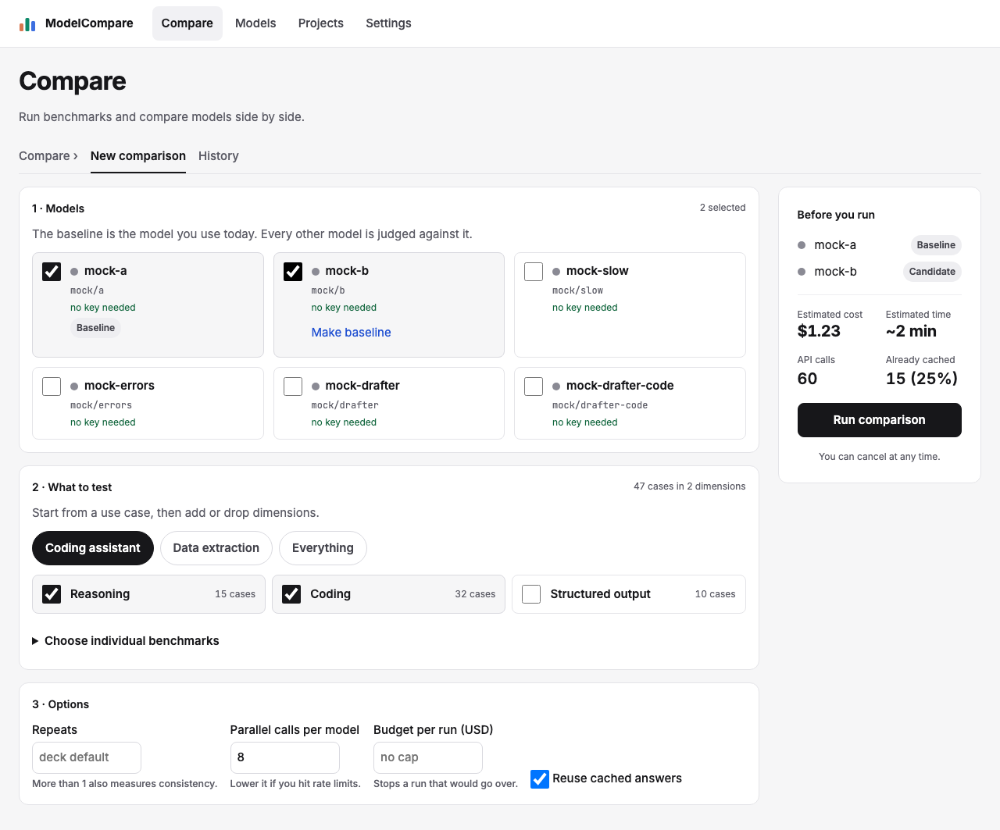
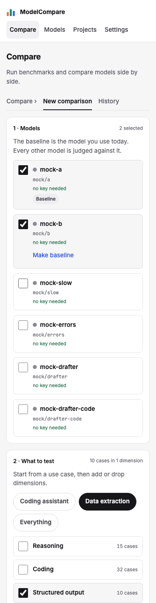

# Review: #34 Concept UI redesign — milestone 4a: capability cards, cost and speed

> **Verdict:** Approve · **Merge risk:** Medium · **Read time:** ~8 min
> Plan: `.claude/plans/34-concept-ui-redesign.md` (row p4, first half) · Evidence: `docs/evidence/34.json` · Autonomy: pr (squashes into `feat/concept-ui-redesign`)

## What and why
The report's ranked bar charts and verdict matrix are replaced with one card per capability. Each card has a bar per model with its 95% range and a verdict chip per candidate. New Cost and Speed sections follow:
- cost per 1k tasks and run spend;
- latency bars (median solid, slowest-benchmark p95 as a lighter tail);
- a quality vs latency scatter with its Pareto line.

Each verdict now has one label everywhere on the page, with its longer meaning as a muted note. Milestone 4 was split into two PRs to stay under 400 lines. Regressions and Evidence follow in 4b.

## Design decisions
| Decision | Chosen | Instead of | Why |
| --- | --- | --- | --- |
| Capabilities | One card per dimension, combining the old ranked bars and verdict matrix | Two separate sections | The board, and one place to read a capability |
| Verdict labels | One set in `VerdictChip`: Better, Worse, Mixed, Tie, Inconclusive (with "n<10" for too little data), Incomplete. The longer meaning ("within 3 points", "fix errors and re-run") is muted text beside the chip | Three wordings for the same verdict across sections | Review Medium: "Equivalent (within 3 points)", "Tie" and "Equivalent" appeared on one page |
| Models with no successful calls | Dropped from the cost and latency lists. Incomplete models are hatched and labelled | Showing $0 and 0 s | The engine reports 0 for them, so they looked cheapest and fastest (review Medium) |
| Latency | Same helper as Key metrics: engine p50, slowest-benchmark p95 | A second calculation | One number per model across the page |
| Sorting | Cost and latency best first (ascending); capability scores highest first | — | Best first in every list |
| Bar fill | `.barlist .fill { display: block }` | — | The fill was an inline span, so milestone 3's pass-rate bars drew empty tracks. Tests now check bar widths |
| CSS name | `.stat-tile` for the cost and speed tiles | `.tile` | The first build overrode Choose's `.tile`, so unselected cards looked selected (review High) |
| Vendor colours | From the model name, as in milestones 1–3 | The report's `vendor` field | Consistent with earlier sections. Seeded `qa-*` models render grey; the colour test uses mocked names |
| Dropped | Input/output cost split, "saved by cache" dollars, judge cost tile | — | No data (plan Concerns) |

## Proof — acceptance criteria
| Criterion | Proven by | Result |
| --- | --- | --- |
| AC-34.8 a card per dimension, a bar per model, a verdict chip per candidate | `.claude/qa/concept-ui.spec.ts:383` (card count equals dimension count; bars and chips per card; fill width ≈ value; whisker spans the CI) and the report capture test; `compare.spec.ts` AC-7.1 and AC-7.2 migrated (sorted, whiskers, vendor colours, incomplete hatched with no whisker, all five labels, "n<10", baseline marked, fits 390 px) | ✔ |
| AC-34.9 cost per 1k bars, run spend, latency bars (p50 solid, p95 tail), quality vs latency scatter | `concept-ui.spec.ts` AC-34.9 tests (one point per model, frontier line, sorted bars, tail width against p95; a no-success model dropped, an incomplete model hatched) and the capture test | ✔ |

Ran against the local app at http://127.0.0.1:8765 (mock targets, seeded reports) on commit `c52e270`: verify passed, API smoke passed, browser 188 of 188, UI audit 0 serious and 10 minor (none on the report or Choose). Diff coverage isn't measured. AC-34.10 and .11 are in 4b; AC-34.13, .14 and .16 are in milestones 5–6.

## Screens
| Screen | After |
| --- | --- |
| Report capabilities and cost/speed, 1280 |  |
| Choose after the `.tile` fix, 1280 |  |
| Choose after the `.tile` fix, 390 |  |

## Risks and findings
Reviewer agent findings on the full milestone 4 diff (the items for this half):
| Sev | Where | Finding | Status |
| --- | --- | --- | --- |
| High | `web/app/globals.css` | New `.tile` rule made unselected Choose cards look selected | Fixed: `.stat-tile` |
| Medium | `web/components/CostSpeed.tsx` | No-success models shown as cheapest and fastest | Fixed |
| Medium | VerdictChip, KeyMetrics, DecisionPanel, CapabilityGrid | Three labels for one verdict | Fixed: one set plus notes |
| Medium | `concept-ui.spec.ts` | No test checks bar widths (how empty bars passed) | Fixed for capability, pass-rate, cost and latency bars |
| Low | CapabilityGrid | "-0 pts"; Tie and Inconclusive had the same tone | Fixed |
| Low | DecisionPanel | "Best by use case" names wrapped mid-name | `.pick` no-wrap, name `overflow-wrap: anywhere` |
| Low | `compare.spec.ts` | Colour test renames models because colour follows the name, not the report's `vendor` | Open: milestone 6 or later (pass `vendors` into `vendorColor`) |
| Low | CostSpeed | Formatters duplicated; latency list is hand-written markup | Open: milestone 6 or later |
| Low (lead) | Quality vs latency scatter | Point labels overlap when models have near-identical latency (every seeded model is 0.4 s) | Open: milestone 6 |

## Review path
Read in this order, riskiest first:
1. `web/app/globals.css`: `.stat-tile`, the `.fill` display fix, card and tail styles (~4 min)
2. `web/components/CapabilityGrid.tsx` (~5 min)
3. `web/components/CostSpeed.tsx` (~5 min)
4. `web/components/ui/VerdictChip.tsx`, and the label changes in `KeyMetrics.tsx` and `DecisionPanel.tsx` (~3 min)
5. `web/components/ui/BarList.tsx` (whisker, hatched, max) (~2 min)
6. `.claude/qa/concept-ui.spec.ts` (AC-34.8, .9, bar widths), then the `compare.spec.ts` and `e2e.spec.ts` migrations (~6 min)

Skip: screenshots under `docs/reviews/34-p4a/`.

## How to test for humans

Where: Not on develop yet
Who: the plan doesn't name an account. The app has no login.
About 5 minutes. The automated checks passed. This is what a person can judge that those checks don't.

### Report: capabilities, cost and speed

1. Open History and click a finished comparison with three or more models
2. Scroll past Quality to Capabilities
3. You should see one card per capability, each with a bar per model (baseline marked), a range whisker, and a verdict chip per candidate
   - Watch for: chip wording. "Tie" in the cards should also read "Tie" in Key metrics and the Recommendation, with "within 3 points" beside it.
4. Scroll to Cost and Speed
5. You should see cost per 1k bars cheapest first, run spend, latency bars fastest first with a lighter p95 tail, and a quality vs latency scatter with a frontier line
6. Scroll back up to Quality
7. You should see the pass-rate bars filled (they were empty tracks before)

### Nearby — should be unchanged

- Compare (Choose): tick two models → only the ticked cards are shaded

### Not covered by the checks

- Real latency spread: seeded models all report 0.4 s. Check the p95 tails on a real run.
- Vendor colours: seeded `qa-*` models are grey. Real Claude, GPT and Gemini models should show their vendor colours.

## Check yourself
- [ ] The single label set (Tie, Inconclusive with n<10) reads well to you
- [ ] Regressions and the per-benchmark table still show the old layout until 4b merges
