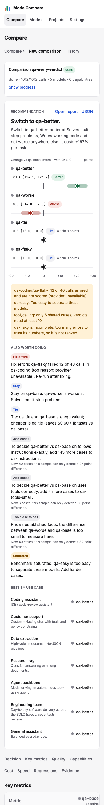

# Review: #34 Concept UI redesign — milestone 4b: regressions side by side, evidence

> **Verdict:** Approve · **Merge risk:** Low–Medium · **Read time:** ~6 min
> Plan: `.claude/plans/34-concept-ui-redesign.md` (row p4, second half) · Evidence: `docs/evidence/34.json` · Autonomy: pr (squashes into `feat/concept-ui-redesign`)

## What and why
The report's last two sections now match the concept.
- **Regressions:** one toggle per candidate. Each case where a candidate lost to the baseline expands to the baseline and candidate outputs side by side, with the scorer's reasons.
- **Evidence:** the per-benchmark statistics table (n, score change, CI, p, McNemar p, W/T/L, verdict) is always visible instead of hidden under "Details", grouped by benchmark, with the method footnote.

This completes the report redesign. Milestone 4a added the capability cards and cost and speed.

## Design decisions
| Decision | Chosen | Instead of | Why |
| --- | --- | --- | --- |
| Candidate switcher | `aria-pressed` toggle buttons in a group, like the History filters | ARIA tabs | The first build had half the tabs pattern (no arrow keys, no panel link). Toggles are complete and match History (review Medium) |
| Default candidate | The candidate with the most regressions | The first candidate | Shows the riskiest switch first |
| Rows | Collapsed until opened; a row's open state is keyed on candidate, benchmark and case | Open by default (board) | The existing AC-7.5 journey asserts "collapsed". The key stops a row staying open when you switch candidate |
| Long outputs | A scrolling box that takes keyboard focus and is named "{model} output" | Plain `<pre>` | Keyboard users couldn't scroll it, and axe flags that as serious (review Medium) |
| Evidence column | "Score change (pts)" | "Change" | It's the paired mean-score change. Next to a pass-rate column it was easy to misread (review Medium) |
| Evidence grouping | A `<th scope="rowgroup">` per benchmark, labelling its rows | `aria-label` on `<tbody>` | Screen readers announce the benchmark with each row (review Medium) |
| Evidence links | The "Open report" and "JSON" links stay in the Recommendation header | Duplicating them under Evidence | A second link with the same name breaks the existing link tests. AC-34.11's link check uses those links |
| Dropped | The old per-benchmark Score column and the "In plain words" block | — | The Recommendation and capability cards carry the same information; no spec asserted them |
| Regressions with one model | Section hidden | An empty switcher | Nothing to compare |

## Proof — acceptance criteria
| Criterion | Proven by | Result |
| --- | --- | --- |
| AC-34.10 a tab per candidate; each regression expands to baseline and candidate outputs side by side with the reason | `.claude/qa/concept-ui.spec.ts` AC-34.10 toggle test (switching candidates changes the list; expanding shows two outputs and reasons), two long-output tests at 1280 and 390 (scrolls, focusable, no page scroll), and the capture test; `compare.spec.ts` AC-7.5 (rows collapsed, "Show all") | ✔ |
| AC-34.11 the per-benchmark table shows n, change, CI, p, McNemar p, W/T/L and verdict; HTML and JSON links work | `concept-ui.spec.ts` AC-34.11 test loops over all 21 comparisons and checks every cell; the HTML report returns 200 and JSON parses; capture test | ✔ |

Existing specs: `run-flow`, `models` and `projects` no longer click "Details" and read the Evidence rowgroup named after the benchmark instead. The projects test now waits up to 30 s for that rowgroup, so it proves the report opened (review Medium). No assertion was dropped.

Ran against the local app at http://127.0.0.1:8765 (mock targets, seeded reports) on commit `87eed8f`: verify passed, API smoke passed, browser 192 of 192, UI audit 0 serious and 10 minor (none on the report). Diff coverage isn't measured. AC-34.13, .14 and .16 are milestones 5–6.

## Screens
| Screen | After |
| --- | --- |
| Regressions and Evidence, 1280 |  |
| Full report, 390 |  |

## Risks and findings
Reviewer agent findings on the full milestone 4 diff (the items for this half):
| Sev | Where | Finding | Status |
| --- | --- | --- | --- |
| Medium | `web/components/Regressions.tsx` | Half the ARIA tabs pattern | Fixed: toggle buttons |
| Medium | `Regressions.tsx` | Scrolling output not keyboard-focusable | Fixed, tested at 1280 and 390 |
| Medium | `web/components/Evidence.tsx` | "Change (pts)" read as pass-rate change | Renamed "Score change (pts)" |
| Medium | `Evidence.tsx` | Benchmark grouping not announced | Fixed: rowgroup header |
| Medium | `.claude/qa/projects.spec.ts` | Without the Details wait, the test could pass before the report loaded | Fixed: waits for the Evidence rowgroup |
| Medium | `concept-ui.spec.ts` | Evidence test checked one comparison | Fixed: every comparison, every cell |
| Low | Regressions, ReportTable, Evidence | Open row carried over between candidates; empty switcher with one model; method footnote missing | Fixed |

## Review path
Read in this order, riskiest first:
1. `web/components/Regressions.tsx`: toggles, default candidate, side-by-side outputs, row keys (~5 min)
2. `web/components/Evidence.tsx`: column mapping and rowgroups (~3 min)
3. `web/components/ReportTable.tsx`: the Details block removed, sections ordered (~2 min)
4. `.claude/qa/concept-ui.spec.ts` AC-34.10 and .11, then `run-flow`, `models`, `projects` and `compare` spec edits (~5 min)

Skip: screenshots under `docs/reviews/34-p4b/`.

## How to test for humans

Where: Not on develop yet
Who: the plan doesn't name an account. The app has no login.
About 4 minutes. The automated checks passed. This is what a person can judge that those checks don't.

### Regressions

1. Open History and click a finished comparison with two or more candidates
2. Scroll to Regressions
3. You should see one button per candidate, the one with the most regressions selected, and a list of cases where it lost to the baseline
4. Click another candidate, then open a case
5. You should see the baseline and candidate outputs side by side with the scorer's reasons
   - Watch for: a long output scrolls inside its box and the page doesn't scroll sideways on a phone

### Evidence

6. Scroll to Evidence
7. You should see one group per benchmark, each with a row per model: n, score change, CI, p, McNemar p, W/T/L and verdict, plus the method note at the end
8. Click "Open report" and "JSON" at the top of the report
9. You should see the HTML report and the raw JSON open

### Nearby — should be unchanged

- A one-model run: the report shows the scorecard and the evidence table, with no Regressions section
- Projects: run a project → its comparison opens to the report with the evidence row for its benchmark

### Not covered by the checks

- Real model outputs with markdown or code: check they stay readable in the side-by-side boxes

## Check yourself
- [ ] Collapsed regression rows (the board shows them open) is acceptable
- [ ] Dropping the old Score column and "In plain words" block is acceptable
