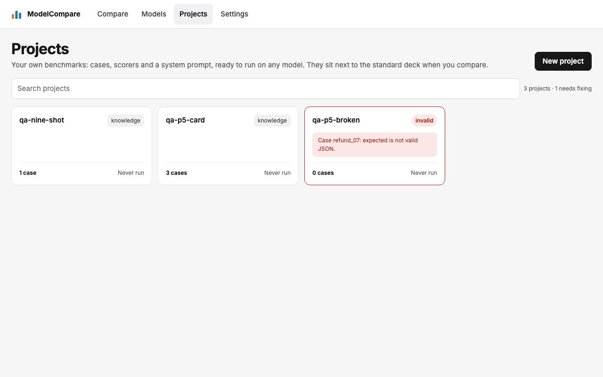
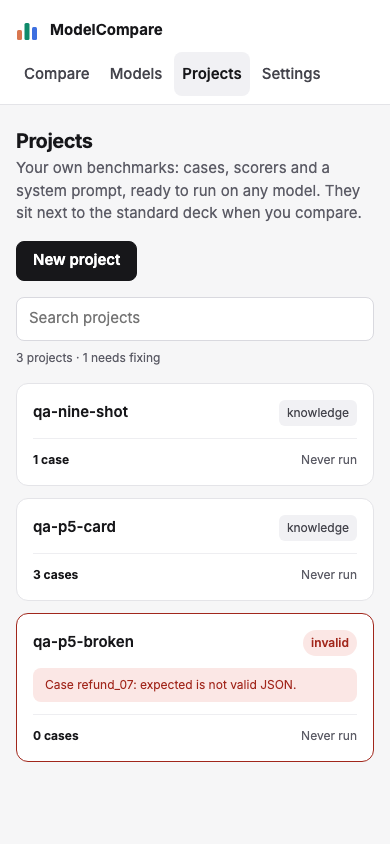
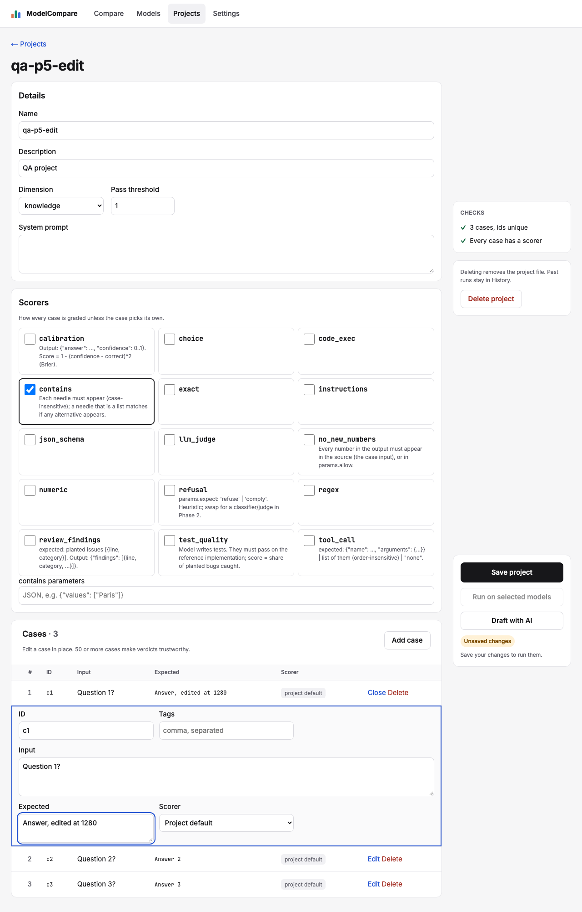
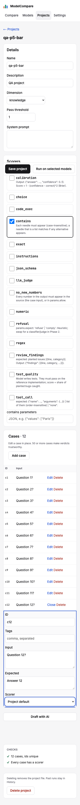
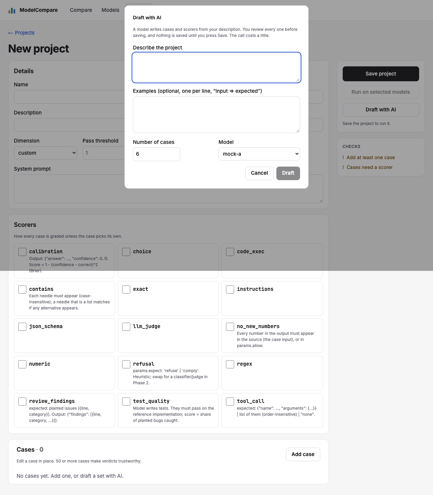

# Review: #34 Concept UI redesign — milestone 5: Projects list and editor

> **Verdict:** Approve · **Merge risk:** Medium · **Read time:** ~8 min
> Plan: `.claude/plans/34-concept-ui-redesign.md` (row p5) · Evidence: `docs/evidence/34.json` · Autonomy: pr (squashes into `feat/concept-ui-redesign`)

## What and why
Projects now match the concept.
- **List:** project cards with a search box and a "needs fixing" count. Invalid projects get a red border, an "invalid" chip and their error.
- **Editor:**
  - details, scorer cards and an inline-edit case table;
  - a sticky action panel: Save; Run, disabled until saved, with the reason; Draft with AI; the unsaved chip;
  - a checks list with "Fix it";
  - delete with confirm.
- **Draft dialog:** restyled, with focus handled properly.

Every fetch, save, run, draft and delete call, and the unsaved-change tracking, are unchanged.

## Design decisions
| Decision | Chosen | Instead of | Why |
| --- | --- | --- | --- |
| Phone action bar | One row capped at 64px with Save and Run; Draft with AI just above it; status at the top of the form; extra scroll padding so focused fields clear it | The full panel stuck to the bottom (about 180px) | Focused fields were hidden under it, which fails WCAG 2.4.11 (review High) |
| Desktop actions | Only the actions card is sticky in the right column | The whole side column sticky | A tall side column, such as with the delete confirm open, couldn't be reached |
| Large projects | The case table draws 25 rows, then "Show all N"; the open case is always drawn and the row limit persists; duplicate-id check is linear | Drawing every row | Real projects have hundreds of cases |
| Add case and Fix it | Scroll the case to the centre and focus its id field | Opening it in place | On a 300-case project the tap seemed to do nothing (review Medium) |
| Checks | Case count and unique ids, scorer coverage, plus the server's per-case errors after a failed save, each with "Fix it" | Client checks only | The board lists API field errors too |
| Scorer cards | Real checkboxes in styled cards | `aria-pressed` buttons | Keeps the existing scorer selectors and native form behaviour |
| Case rows | Explicit Edit and Delete buttons, id as mono text | The id as the button | Existing journeys use the "Edit case N" names |
| Draft dialog | Current fields, title "Draft with AI", confirm "Draft"; focus moves in, stays in, Escape closes, focus returns | The board's cost line ("About $0.04") | No data source for the cost; specs match the names |
| Not built | Card description and scorer tags; "Draft with AI" on the list | — | The projects list API doesn't return them; opening the dialog from the list would need a new route |
| Report tests | A shared `openReport` helper that waits up to 15 s for the Recommendation | Playwright's 5 s default | A finished report takes about 1.1 s to build server-side, and under two parallel workers that raced (review Medium; no engine change) |

## Proof — acceptance criteria
| Criterion | Proven by | Result |
| --- | --- | --- |
| AC-34.13 cards with invalid ones flagged; the editor has details, scorer cards, an inline-edit case table, sticky actions (Run disabled while unsaved), checks, delete with confirm and the AI draft dialog; saving and running behave as today | `.claude/qa/concept-ui.spec.ts:569` (cards, invalid flagged, text visible at 1280 and 390), `:592` (Run disabled until save with reason; inline edit marks unsaved, Save clears it), `:622` (checks and Fix it), `:634` (300 cases: 25 rows, Show all, focus to case 26, inline edit), `:650` (Add case and Fix it scroll into view and focus, case 300), `:668` (390 bar ≤ 64px; focused fields stay above it), `:688` (dialog focus in, trapped, Escape, focus returns), `:713` (delete confirm and cancel); existing `projects.spec.ts` and `e2e.spec.ts` journeys (create, draft, save, run) | ✔ |
| AC-34.15 (Projects) loading, empty, error-with-retry | `concept-ui.spec.ts:728` (list error, Retry refetches, empty next step), `:741` (editor loading, error with retry, missing project links back) | ✔ |

Existing specs: in `projects.spec.ts` and `e2e.spec.ts`, list rows became card articles. Text checks use `getByText(...)` plus `toBeVisible()` at 1280 and 390, so the narrow-screen guarantee holds (review Medium). No assertion was dropped.

Ran against the local app at http://127.0.0.1:8765 (mock targets, isolated projects dir) on commit `64e23cd`: verify passed, API smoke passed, browser 202 of 202, UI audit 0 serious and 9 minor. The project editor's old tap-target finding is fixed. Diff coverage isn't measured. AC-34.14 and .16 are milestone 6.

## Screens
| Screen | After |
| --- | --- |
| Projects list, 1280 |  |
| Projects list, 390 |  |
| Project editor, 1280 |  |
| Project editor, 390 (full page; the action bar is sticky to the viewport) |  |
| Draft dialog, 1280 |  |

## Risks and findings
Reviewer agent findings (High = blocking, fixed before this PR opened; Medium = recommended):
| Sev | Where | Finding | Status |
| --- | --- | --- | --- |
| High | `web/app/globals.css` | The 390 action bar covered focused fields | Fixed, with a spec |
| Medium | `ProjectEditor.tsx`, `CaseTable.tsx` | Fix it and Add case opened off-screen cases without focus | Fixed, with a spec at case 300 |
| Medium | `projects.spec.ts` | 390 checks weakened to `toContainText` | Restored to visible checks |
| Medium | report specs | Real timing race on report load | Spec wait raised to 15 s; server-side caching suggested as a follow-up (engine change, out of scope) |
| Low | RunDialog, CaseTable, ProjectEditor, Dialog, CSS | Button order; focus after Show all; server errors missing from checks; focus-return guard; whole side column sticky | All fixed |
| Low | `ProjectsView.tsx` | Cards lack description and scorer tags | Known deviation: no data in the list API |

## Review path
Read in this order, riskiest first:
1. `web/components/ProjectEditor.tsx`: layout, actions panel, checks, Fix it (~8 min)
2. `web/components/CaseTable.tsx`: row window, reveal and focus, duplicate ids (~5 min)
3. `web/app/globals.css`: `proj-*` styles and the phone bar (~4 min)
4. `web/components/Dialog.tsx`, `DraftDialog.tsx`, `RunDialog.tsx` (~3 min)
5. `web/components/ProjectsView.tsx` (~2 min)
6. `.claude/qa/concept-ui.spec.ts:569-760`, then the `projects.spec.ts`, `e2e.spec.ts` and `openReport` changes (~6 min)

Skip: screenshots under `docs/reviews/34-p5/`.

## How to test for humans

Where: Not on develop yet
Who: the plan doesn't name an account. The app has no login.
About 7 minutes. The automated checks passed. This is what a person can judge that those checks don't.

### Projects list

1. Open /projects/
2. You should see a card per project with its dimension, case count and last run. An invalid project has a red border, an "invalid" chip and its error.
3. Type part of a project name in the search box
4. You should see the cards narrow to matches

### Editor

5. Open one of your real projects (ideally a large one)
6. You should see Details, Scorers, Cases (25 rows, then "Show all") and, on the right, Save, Run, Draft with AI and the checks list
7. Edit a case's expected answer
8. You should see "Unsaved changes", with Run disabled and saying why. Save clears it and enables Run.
9. Click "Add case"
10. You should land on the new case with its id field focused, even at the end of a long list
11. Narrow the window to phone width and tab through a case's fields
12. You should see a slim Save/Run bar at the bottom that never hides the field you're on
13. Click "Draft with AI", then press Escape
14. You should see the dialog close and focus return to the button

### Nearby — should be unchanged

- Run a saved project on two models → it opens its comparison and report as before
- Delete a test project → it asks to confirm. Cancel keeps it.

### Not covered by the checks

- Your large real project (`my-dev-workflow`): QA uses an isolated projects folder. Open it with the command from earlier (port 8766 against the demo data) and check the case table feels responsive.

## Check yourself
- [ ] On phones the Run reason sits at the top of the form, not beside the button (the button is described by it for screen readers)
- [ ] Cards without description and scorer tags look complete enough
- [ ] Server-side report caching as a follow-up issue (reports take about 1.1 s to build)
