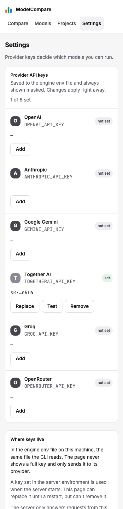
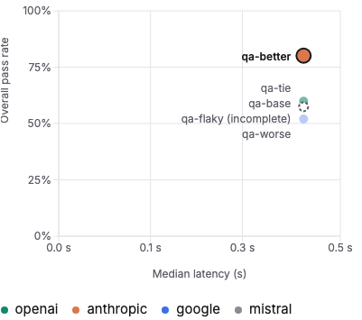

# Review: #34 Concept UI redesign — milestone 6: Settings and the final pass

> **Verdict:** Approve · **Merge risk:** Low–Medium · **Read time:** ~7 min
> Plan: `.claude/plans/34-concept-ui-redesign.md` (row p6) · Evidence: `docs/evidence/34.json` · Autonomy: pr (squashes into `feat/concept-ui-redesign`)

## What and why
This is the last milestone, and it does three things:
- **Settings matches the concept.** Each provider row shows its status, the masked key, and Replace, Test and Remove inline. A "Where keys live" panel explains where keys are stored.
- **A typed API key never reaches the page's HTML.** That was a gap in the current code, not one the redesign introduced: while the form was open, and after a failed save, the key sat in the input's HTML.
- **The whole redesign is proven.** An axe accessibility check and a no-sideways-scroll check now run on all six main routes at 1280 and 390 px. The quality vs latency scatter labels from milestone 4 are also fixed.

## Design decisions
| Decision | Chosen | Instead of | Why |
| --- | --- | --- | --- |
| Key input | Uncontrolled password input, read from a ref on submit and cleared in `finally`. Only a "has value" flag drives the Save button | A controlled input | React writes a controlled value into the HTML, so `page.content()` held the full key while typing and after a failed save (review Medium; breaks AC-34.14) |
| Failed save | Clears the typed key; the user retypes it | Keeping it in the field | Keeps the key out of the page in every state |
| "Where keys live" copy | The board's text without a fixed path. It explains environment keys: used at server start; this page can replace them until a restart but can't remove them. It keeps "The server only answers requests from this machine." | "takes precedence and is only read" | The old line was wrong while the server runs. The path comes from configuration. The loopback line is true (`api.py`) |
| Status chips | "not set", "set", "from environment" | The board's capitalised text | The existing Settings specs assert these |
| Loading state | Six skeleton key rows inside the real card | A short generic skeleton card | Removes a layout jump at 390 (CLS 0.25) |
| Scatter labels | One side label per cluster of close models, best first, frontier models bold, clamped inside the plot and flipped near edges | A label per dot, stacked | Stacked labels drifted away from their dots and read as the wrong pass rate (review High) |
| Accessibility proof | axe-core, pinned as a dev dependency at 4.14.0, fails on serious or critical; plus a horizontal-scroll check, on six routes × two widths | Relying on the UI audit alone | AC-34.16 needs a tagged, repeatable test |
| Choose regression | `.tile-flag` restored | — | An accidental edit had moved "Baseline" and "Make baseline" 8 px (review Medium) |

## Proof — acceptance criteria
| Criterion | Proven by | Result |
| --- | --- | --- |
| AC-34.14 status, masked key, inline Replace, Test and Remove; environment key says so; the full key never appears | `.claude/qa/concept-ui.spec.ts:765` (add, test, replace, remove with `togetherai`; the key is never in `page.content()`; cleanup in `afterEach`), `:801` (key absent while the form is open and after a mocked 422), `:816` (environment key labelled, no Remove), `:827` (390); existing `settings.spec.ts` AC-4.x unchanged and passing | ✔ |
| AC-34.15 (Settings) loading, empty, error-with-retry | `concept-ui.spec.ts:837`, `:848` | ✔ |
| AC-34.16 every existing journey and pytest pass; UI audit 0 serious at 1280 and 390 | `concept-ui.spec.ts:904`: axe on `/compare/`, `/compare/?job=qa-every-verdict`, `/history/`, `/models/`, `/projects/` and `/settings/` at 1280 and 390, with no horizontal scroll; full suite 222 of 222; pytest passing; UI audit 0 serious | ✔ |
| AC-34.9 (fix carried from milestone 4) scatter labels | `concept-ui.spec.ts:884` (no overlap, no label over a dot), `:890` (labels inside the plot near 100% and 0%) | ✔ |

Ran against the local app at http://127.0.0.1:8765 (mock targets, isolated keys file) on commit `3656219`: verify passed (pytest, lint with 0 warnings, build), API smoke passed, browser 222 of 222, UI audit 0 serious and 9 minor. The minor findings are clipped visually-hidden text on History and Models, all pre-existing. Acceptance coverage now passes for all of AC-34.1–.16. Diff coverage isn't measured.

## Screens
| Screen | After |
| --- | --- |
| Settings, 1280 |  |
| Settings, 390 |  |
| Quality vs latency, close models |  |

## Risks and findings
Reviewer agent findings (High = blocking, fixed before this PR opened; Medium = recommended):
| Sev | Where | Finding | Status |
| --- | --- | --- | --- |
| High (non-blocking) | `web/components/QualityScatter.tsx` | Stacked labels drifted from their dots | Fixed: cluster labels, tests for dots and bounds |
| Medium | `web/components/KeyRow.tsx` | Full key in the HTML while typing and after a failed save | Fixed: uncontrolled input, two new tests |
| Medium | `web/app/settings/page.tsx` | Environment-key copy wrong; board copy replaced | Fixed |
| Medium | `KeyRow.tsx` | Flat heading outline | Provider names are `h3` |
| Medium | `web/app/globals.css` | `.tile-flag` regression on Choose | Reverted |
| Medium | `concept-ui.spec.ts` | axe found only through a machine-local copy | Repo path plus a pinned devDependency |
| Medium | `QualityScatter.tsx` | Labels could leave the plot | Clamped and flipped, tested |
| Low | Settings, KeyRow, HistoryView | Loading layout shift; badge contrast; unused import | Fixed. Badge contrast unmeasured (the badge is decorative and hidden from assistive tech) |
| Low | spec | axe runs only on each route's first state | Open: optional follow-up |

## Review path
Read in this order, riskiest first:
1. `web/components/KeyRow.tsx`: key input handling (~5 min)
2. `.claude/qa/concept-ui.spec.ts:760-910`: Settings, scatter and axe tests (~8 min)
3. `web/components/QualityScatter.tsx`: cluster labels (~5 min)
4. `web/app/settings/page.tsx` next to `.claude/design/concept-ui/Settings.dc.html`: copy and layout (~4 min)
5. `web/app/globals.css` and `web/package.json` (axe-core devDependency) (~2 min)

Skip: `web/package-lock.json`, screenshots under `docs/reviews/34-p6/`.

## How to test for humans

Where: Not on develop yet
Who: the plan doesn't name an account. The app has no login.
About 5 minutes. The automated checks passed. This is what a person can judge that those checks don't.

### Settings

1. Open /settings/
2. You should see six provider rows, each with a status chip and either a masked key or a dash, plus the "Where keys live" panel
3. Click Add on a provider you don't use, paste an obviously fake key, and Save
4. You should see "set" and a masked key like `sk-…abcd`, never the full key
   - Watch for: the "Where keys live" text should match how you actually run the server
5. Click Test, then Remove and confirm
6. You should see the test result inline, then the row back to "not set"

### Final pass

7. Narrow the window to phone width and visit Compare, a finished report, History, Models, Projects and Settings
8. You should see no sideways scrolling anywhere

### Nearby — should be unchanged

- Compare (Choose): "Baseline" and "Make baseline" line up with the model name
- A finished report's Speed section: close models share one label beside their dots

## Check yourself
- [ ] A failed key save clears the field, so it has to be retyped
- [ ] Cluster labels list several models beside a group of dots instead of one label per dot
