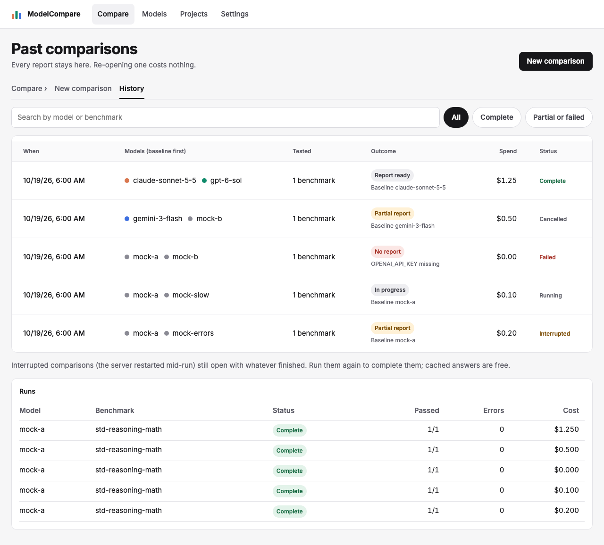
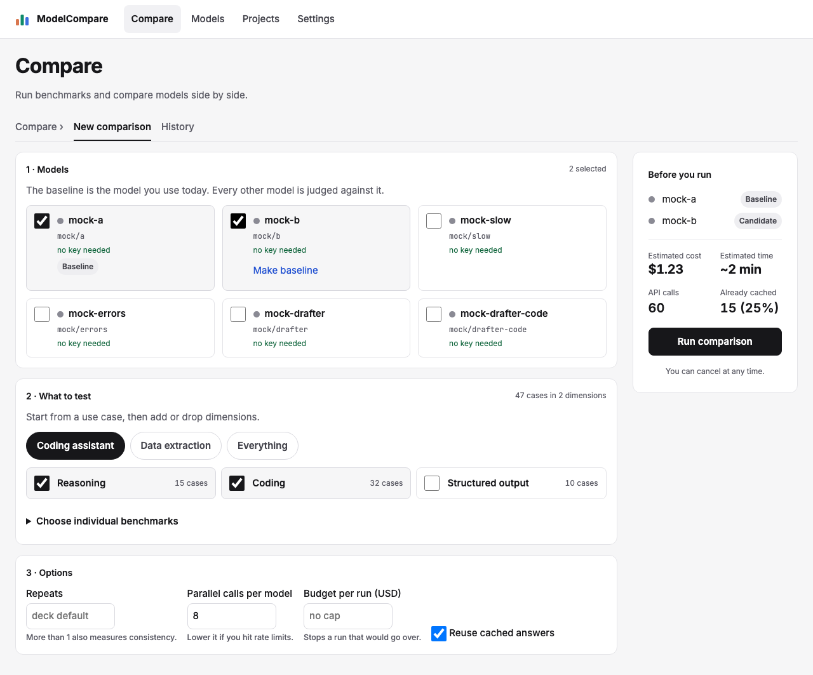
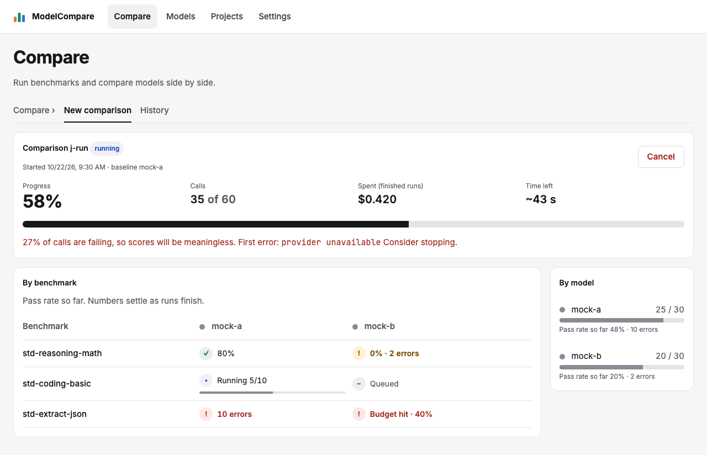
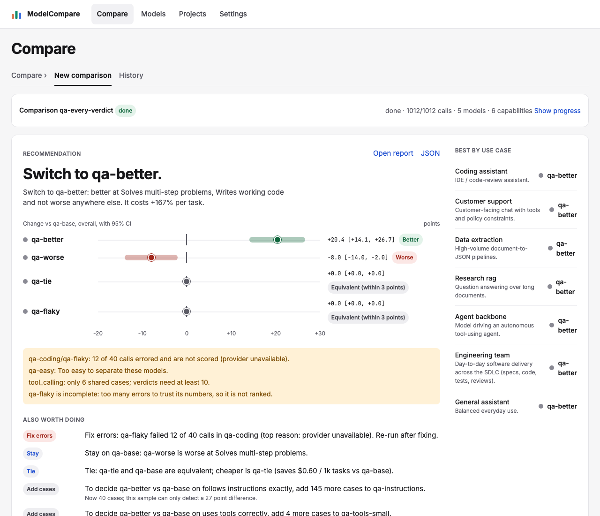
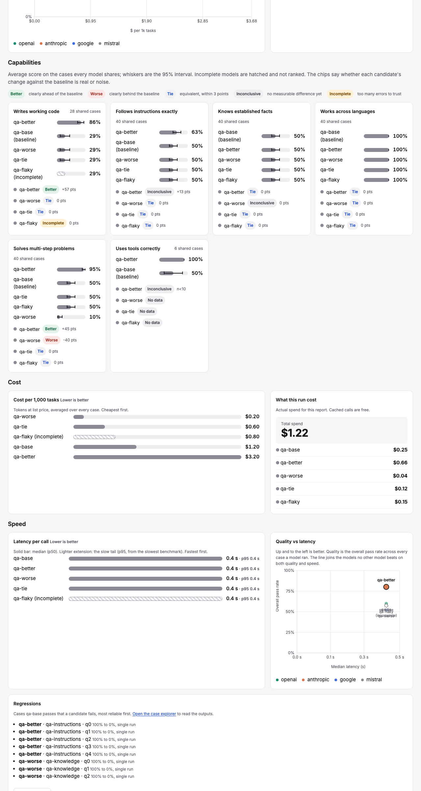
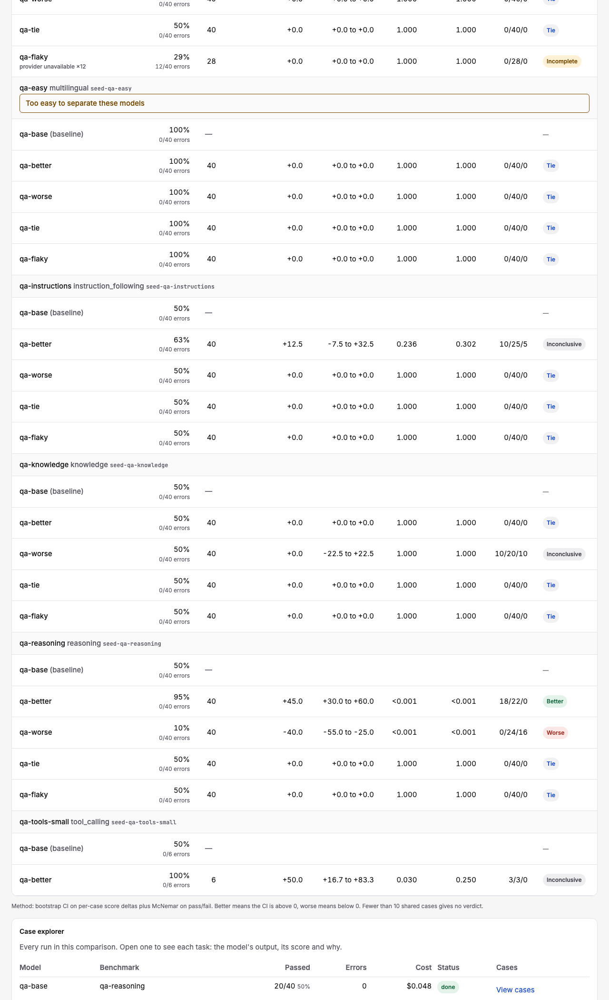
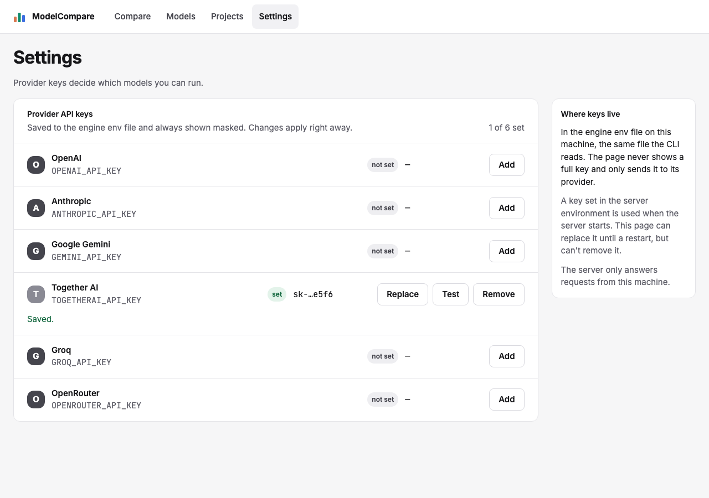
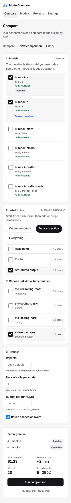

# Review: #34 Concept UI redesign — Compare, Projects and Settings

> **Verdict:** Approve · **Merge risk:** Medium · **Read time:** ~15 min (the milestone reviews below have the detail)
> Plan: `.claude/plans/34-concept-ui-redesign.md` · Evidence: `docs/evidence/34.json` · Autonomy: pr (feature release into `feat/dashboard-v2-redesign`; not merged by the agent)

## What and why
The dashboard now matches the approved concept canvas, on the same routes and the same API:
- **Compare:** Choose, then Run, then a decision-first report.
- **History, Projects and Settings:** redesigned in the same visual language.
- **Models:** picks up the new tokens only.

The v2 dashboard worked but didn't look finished. The report buried the decision under tables, and screens didn't share one look. No engine or API changes. Light theme only, with every colour a token so dark mode can come later.

## Milestones
| # | PR | Scope | Criteria | Counted lines | Review |
| --- | --- | --- | --- | --- | --- |
| 1 | #35 | Tokens, type, primitives, top bar, section tabs, states, History | AC-34.1, .12, .15 | 371 | [34-p1](34-p1.md) |
| 2 | #36 | Choose and Run | AC-34.2, .3 (amended), .4 | 390 | [34-p2](34-p2.md) |
| 3 | #37 | Report top: recommendation, key metrics, quality | AC-34.5, .6, .7 | 386 | [34-p3](34-p3.md) |
| 4a | #38 | Capability cards, cost and speed | AC-34.8, .9 | 325 | [34-p4a](34-p4a.md) |
| 4b | #39 | Regressions side by side, evidence | AC-34.10, .11 | 217 | [34-p4b](34-p4b.md) |
| 5 | #40 | Projects list and editor | AC-34.13, .15 | 300 | [34-p5](34-p5.md) |
| 6 | #41 | Settings, final pass, scatter labels | AC-34.14, .15, .16 | 152 | [34-p6](34-p6.md) |

The plan had six milestones. Milestone 4 came in at 515 lines and was split into 4a and 4b to keep every PR at 400 lines or fewer.

## Design decisions
| Decision | Chosen | Instead of | Why |
| --- | --- | --- | --- |
| Styling | Our own CSS tokens and primitives (ADR `docs/context/decisions/2026-10-21-ui-tokens-restyle.md`) | Tailwind or a UI kit | No new dependency, no rewrite; dark mode is a later token override |
| Navigation | Current routes and nav; Choose, Run and Report at `/compare/` and `/compare/?job=`; History a Compare sub-tab | The concept's new nav and routes | Keeps links and every journey working (plan Grill 2) |
| One-model runs | One model still runs as a scorecard; Start is disabled only with no model | Disabling below two (original AC-34.3) | User decision during milestone 2 (plan Grill 5); AC-34.3 amended |
| Report order | Recommendation first (lead decision ranked by size of gain), then key metrics, quality, capabilities, cost, speed, regressions, evidence | The old tables-first report | The decision is the point of the page |
| One verdict vocabulary | Better, Worse, Mixed, Tie, Inconclusive (with "n<10"), Incomplete, plus a muted note for the longer meaning | Different wording per section | The first build used three words for one verdict on one page |
| Latency | Engine p50 and slowest-benchmark p95, skipping benchmarks with no successful calls | An average of p95s | Matches the engine; an average hides the tail |
| API keys | Uncontrolled password input, cleared on every outcome | Controlled input | The typed key had been in the page's HTML (a gap in the current code), which AC-34.14 forbids |
| Dropped (no data) | The input/output cost split, the live per-case feed, "saved by cache" dollars, the draft cost estimate, description and scorer tags on project cards | — | The API doesn't provide them, and the plan rules out API changes |

## Proof — acceptance criteria
Every criterion is covered by a tagged browser test against the running app. Line numbers are in `.claude/qa/concept-ui.spec.ts` unless noted.

| Criterion | Proven by | Result |
| --- | --- | --- |
| AC-34.1 Shell: top bar, tokens, no horizontal scroll at 390 | `:24` (5 routes × 1280 and 390), `:904` (axe and no scroll on 6 routes) | ✔ |
| AC-34.2 Choose: key status, a missing-key model can't be picked, a baseline | `:144` | ✔ |
| AC-34.3 Choose deck and estimate (amended) | `:161`; `run-flow.spec.ts` one-model scorecard journey | ✔ |
| AC-34.4 Run: percent, calls, spend, time left, per-model progress, grid states, Cancel | `:218`; `run-flow.spec.ts` live and cancel journeys | ✔ |
| AC-34.5 Decision first, with the overall change and its CI, use cases, caveats | `:255`, `:349` (order-independent headline), `:357` (first screen at 390) | ✔ |
| AC-34.6 Key metrics, best value per row | `:295` | ✔ |
| AC-34.7 Quality vs cost with the Pareto line; sorted pass-rate bars | `:324` (with bar widths); `compare.spec.ts` AC-7.3 | ✔ |
| AC-34.8 Capability cards | `:383`; `compare.spec.ts` AC-7.1 and AC-7.2 | ✔ |
| AC-34.9 Cost and speed, latency scatter | `:447`, `:884`, `:890` and the cost and speed tests | ✔ |
| AC-34.10 Regressions per candidate, side by side with reasons | the regressions toggle and long-output tests; `compare.spec.ts` AC-7.5 | ✔ |
| AC-34.11 Evidence table; HTML and JSON links | the every-comparison evidence test | ✔ |
| AC-34.12 History | `:37`, `:74` | ✔ |
| AC-34.13 Projects | `:569`, `:592`, `:622`, `:634`, `:650`, `:668`, `:688`, `:713` | ✔ |
| AC-34.14 Settings; the full key never appears | `:765`, `:801`, `:816`, `:827` | ✔ |
| AC-34.15 Loading, empty, error-with-retry | `:83`, `:102`, `:728`, `:741`, `:837`, `:848` | ✔ |
| AC-34.16 No regressions; 0 serious accessibility findings at 1280 and 390 | `:904` plus the full suite and pytest | ✔ |

Whole feature, run once on `feat/concept-ui-redesign` after the last milestone merged, against the local app at http://127.0.0.1:8765 (mock targets, seeded reports, isolated data and keys):
- verify passed (pytest, lint with 0 warnings, build) and API smoke passed;
- browser checks: 222 of 222;
- UI audit: 0 serious and 9 minor findings (clipped visually hidden text on History and Models, pre-existing);
- acceptance coverage passed for all 16 criteria;
- diff coverage isn't measured, because no coverage command is configured.

## Screens
| Screen | After |
| --- | --- |
| History |  |
| Choose |  |
| Run |  |
| Report top |  |
| Capabilities, cost and speed |  |
| Regressions and evidence |  |
| Projects list |  |
| Project editor |  |
| Settings |  |
| Choose, 390 |  |

## Risks and findings
Every High and Medium from the reviewer's pass on each milestone was fixed before that milestone merged. These are the items that remain:
| Sev | Where | Item | Next step |
| --- | --- | --- | --- |
| Medium | engine `/api/jobs/{id}/report` | A finished report takes about 1.1 s to build and caused a flaky test under parallel runs. The specs now wait up to 15 s | Follow-up: cache reports for finished jobs (engine change, outside this plan) |
| Low | `web/lib/vendor.ts` | Vendor colour follows the model name, not the report's `vendor` field; seeded `qa-*` models are grey | Follow-up: pass the report's vendors into `vendorColor` |
| Low | CostSpeed, KeyMetrics, QualityScatter | Number formatters duplicated three times | Follow-up: `web/lib/format.ts` |
| Low | `concept-ui.spec.ts:904` | axe covers each route's first state only, not edit, confirm or error states | Optional follow-up |
| Low | History | Empty-state copy says "with its status" where the board says "with its recommendation" (the list has no recommendation) | Confirm wording |
| Low | Report | Section tabs have no active-section highlight | Optional follow-up |
| Info | QA harness | Builder left spec copies under `~/.claude/skills/qa/playwright/runs/m4dev` (outside the repo; the delete guard blocked removal) | Delete by hand if you like |

## Review path
Read in this order, riskiest first:
1. `web/components/KeyRow.tsx` and `web/app/settings/page.tsx`: key handling (~5 min)
2. `web/components/DecisionPanel.tsx`, `KeyMetrics.tsx`: what the report recommends and highlights (~10 min)
3. `web/components/RunForm.tsx`, `JobView.tsx`: Choose and Run (~10 min)
4. `web/components/ProjectEditor.tsx`, `CaseTable.tsx`: Projects (~8 min)
5. `web/app/globals.css`: tokens and primitives (~8 min)
6. `CapabilityGrid.tsx`, `CostSpeed.tsx`, `QualityScatter.tsx`, `Regressions.tsx`, `Evidence.tsx` (~10 min)
7. `.claude/qa/concept-ui.spec.ts` and the edits to existing specs (~10 min)

Skip: screenshots under `docs/reviews/34-*/`, `web/package-lock.json`.

## How to test for humans

Where: Not on develop yet. Run this branch locally: `cd engine && .venv/bin/modelcompare serve --port 8765` after `cd web && npm run build`. To see your own projects and runs, point it at your demo data instead: `MODELCOMPARE_HOME`, `MODELCOMPARE_CUSTOM_DIR` and `MODELCOMPARE_KEYS_FILE` set to the dashboard-v2 worktree's `engine/.modelcompare-demo`, on port 8766.
Who: the plan doesn't name an account. The app has no login.
About 10 minutes. The automated checks passed. This is what a person can judge that those checks don't.

### Look and History

1. Open /compare/, /history/, /models/, /projects/ and /settings/
2. You should see the new top bar with the current page highlighted, on the light canvas, with no sideways scroll at phone width
3. On /history/, click "Partial or failed", then a row
4. You should see the list narrow, then land on that comparison's report

### Choose and Run

5. On /compare/, tick two models, make the second the baseline, pick a use-case preset and toggle a dimension
6. You should see the baseline marker move and the sticky estimate (cost, time, calls, cached) update
7. Click "Run comparison"
8. You should see percent, calls, spend (finished runs), time left, per-model bars and the benchmark × model grid fill in

### Report

9. When it finishes, read the top of the report
10. You should see the recommendation first, with a range bar and verdict per candidate, then best by use case and caveats
    - Watch for: does the headline match the bars? The candidate whose range sits right of zero should be the switch.
11. Scroll through Key metrics, Quality, Capabilities, Cost, Speed, Regressions and Evidence
12. You should see the best values tinted, filled bars, one card per capability, and the same verdict words everywhere. Regressions open to side-by-side outputs with reasons.

### Projects and Settings

13. Open one of your real projects and edit a case
14. You should see "Unsaved changes", with Run disabled and saying why until you save
15. On /settings/, add an obviously fake key to a provider you don't use, then Test and Remove it
16. You should only ever see the masked key

### Nearby — should be unchanged

- Models: tick two models, then "Compare selected" → Choose opens with them ticked
- The downloadable HTML report ("Open report") still opens the old-style report

### Not covered by the checks

- Real latency and vendor colours: seeded models all report 0.4 s and render grey
- Your large real project: QA uses an isolated projects folder

## Check yourself
- [ ] The amended AC-34.3 (one model runs as a scorecard) is what you want
- [ ] Dropped concept features (cost split, live case feed, card tags, draft cost) are acceptable without API work
- [ ] Follow-ups to file: report caching, vendor map, shared formatters
