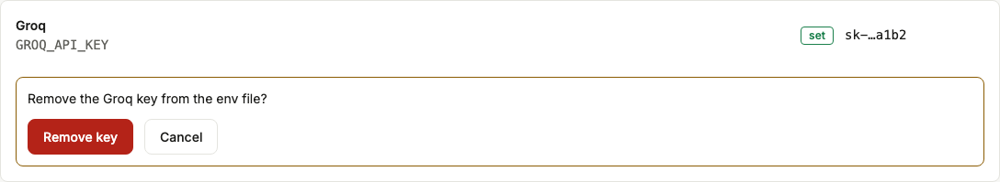
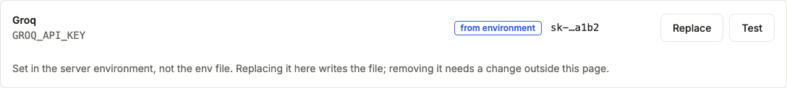
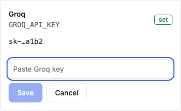
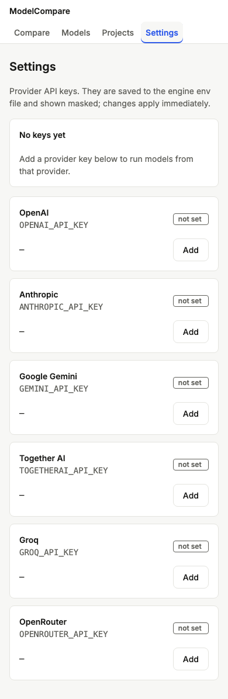

# Review: #4 Settings — provider keys

> **Verdict:** Approve · **Merge risk:** Medium (writes secrets to a file from HTTP) · **Read time:** ~15 min
> Plan: `.claude/plans/4-dashboard-v2-settings.md` · Evidence: `docs/evidence/4.json` · Autonomy: pr

Ships as two stacked PRs into `feat/dashboard-v2-redesign` (see the plan's PR split):
| Part | Branch | Content | Counted lines |
| --- | --- | --- | --- |
| 4a | `feat/dashboard-v2-redesign-p4a-keys` | `keys.py`, settings API with Host/Origin checks, CLI key loading, ADR | 286 |
| 4b | `feat/dashboard-v2-redesign-p4b-settings` | Settings page and `KeyRow` | 157 |

The full QA gate runs on 4b. On 4a only AC-4.5 (the UI) is reported as still to come.

## What and why
The Settings page lets you add, replace, test and remove an API key for each provider (OpenAI, Anthropic, Gemini, Together, Groq, OpenRouter). Keys are written to the engine env file, the same file the CLI already reads. They are shown only masked (`sk-…a1b2`) and take effect without a restart. Editing that file by hand was the main friction.

## Design decisions
| Decision | Chosen | Instead of | Why |
| --- | --- | --- | --- |
| Store | The engine env file (`MODELCOMPARE_KEYS_FILE` overrides it), package-relative like the old `load_dotenv()` | OS keychain; SQLite | The CLI already reads it. ADR `2026-10-19-keys-in-env-file.md` |
| Write | Rewrite only that variable's line (duplicates collapsed). Temp file 0600 → fsync → `os.replace`, symlink target preserved, under a lock. No-op deletes don't touch the file | Rewriting the whole file | Every other line kept byte for byte, including CRLF, `export` and comments |
| Values | Printable ASCII ≤512 chars; no whitespace, quotes, `#`, `$` or backslash; written bare | Quoting | Kills line injection and dotenv quoting edge cases |
| Access | `/api/settings/*` only (no root alias). Strict Host regex (localhost / 127.0.0.1 / [::1], any port). `Origin`, if present, must be one of those. PUT requires JSON | Host check only | A hostile page's form POST to 127.0.0.1 passes a Host check; the Origin check stops it. Cross-site PUT/DELETE need a preflight, which fails (no CORS) |
| Leaks | Responses `{provider, var, set, masked, source}`. Fixed-string errors. The 422 never echoes the body. The probe drops exception text | Pydantic validation errors | Validation errors would echo the value |
| Source | Effective value (`os.environ` first). `environment` when the shell's value differs from the file's. Environment-only keys can't be removed (409) | Showing the file value | A shell-exported key wins at runtime; the page shows what runs actually use |
| Test | One cheap authenticated call to the provider's list-models (OpenRouter: `/api/v1/key`), 10 s timeout | A completion call | Free and fast |

## Proof — acceptance criteria
| Criterion | Proven by | Result |
| --- | --- | --- |
| AC-4.1 PUT writes, a second PUT replaces, DELETE removes. Other lines untouched; mode 600 | `engine/tests/test_keys.py:31`, `:47`, `:56`, `:184`, `:206` (duplicates, `export`, indented, quoted, CRLF), `:214` (symlink) | ✔ |
| AC-4.2 only the masked form, never the value in any response or the DOM | `test_keys.py:77` (scans every response), `:93`, `:130`, `:174`; `.claude/qa/settings.spec.ts:14` (DOM, browser); `.claude/qa/api-smoke.json:6` | ✔ |
| AC-4.3 `Host: evil.example` → 403; unknown provider → 404 | `test_keys.py:98` (Host, lookalikes, foreign/`null` Origin), `:63` (injection values → 422, file unchanged), `:222` (415); `api-smoke.json:7–8` (foreign Origin, 404) | ✔ |
| AC-4.4 after PUT, `/api/targets/status` reports the key with no restart | `test_keys.py:119` | ✔ |
| AC-4.5 add, replace, test and remove, with loading, empty and error states | `settings.spec.ts:14`, `:53`, `:62`, `:69`, `:78`, `:87` (browser; the Test result is route-mocked) | ✔ |

Ran against: the local app at http://127.0.0.1:8765 with an isolated QA keys file and fake values, on commit `37db984`. 824 pytest tests pass (the network is blocked in tests), 41 browser tests pass, web lint and build pass. UI audit: 0 serious, 0 minor. Diff coverage was not measured. The Host check is proven in pytest only, because Node `fetch` can't set `Host`.

## Screens
| Screen | After |
| --- | --- |
| Key set, 1280 |  |
| Remove confirm, 1280 |  |
| From environment, 1280 |  |
| Edit, 390 |  |
| Empty, 390 |  |

## Risks and findings
Reviewer agent: round 1 requested changes (1 High, 5 Medium, Lows), all fixed. Round 2 approved (0 High). Its open items:
- Medium: `find_dotenv()` falls back to the cwd under a debugger or tracer, or in a REPL (same as the old `load_dotenv()`, so not a regression).
- Medium: tests block httpx only, not raw sockets or aiohttp.
- Low: Cancel on the remove confirmation returns focus to Replace, not Remove; the "from environment" chip stretches on mobile; no directory fsync after `os.replace`.

Its Low on `LITELLM_MODE` (`setdefault` would keep an exported `DEV`) was fixed in 4a.
| Sev | Where | Finding | Status |
| --- | --- | --- | --- |
| High | `keys.py` resolver | The default keys file depended on the cwd (`usecwd=True`) | Fixed: package-relative, cwd-independence test |
| Medium | `keys.py` status | Showed the file value while a shell-exported key won at runtime | Fixed |
| Medium | `keys.py` remove | Popped shell-exported keys and rewrote the file on no-ops | Fixed (409 for environment-only keys) |
| Medium | tests | A real HTTPS call to api.openai.com; litellm loaded a real `.env` into pytest | Fixed: network blocked, `LITELLM_MODE=PRODUCTION` in tests and the QA app |
| Medium | tests | Byte-exact claim proven for one layout only | Fixed: duplicate, `export`, indented, quoted, CRLF and symlink cases |
| Low | `api.py` | Loose Host parsing; PUT ignored Content-Type; no fsync | Fixed |
| Low | `KeyRow.tsx` | Focus loss, status not announced, remove not styled as destructive | Fixed |
| **Follow-up** | `api.py` (rest of `/api`) | Run/compare endpoints have no Host check, so a DNS-rebinding page could start paid runs with your keys | **Open**: not in this plan's scope. Recommend applying the same Host/Origin dependency to every mutating `/api` route in a small hardening change |

## Review path
Read in this order, riskiest first:
1. `engine/modelcompare/keys.py`: resolver, line rewrite, validation, status, remove (~8 min)
2. `engine/modelcompare/api.py`, settings router: Host/Origin dependency, PUT body handling, probe (~4 min)
3. `engine/modelcompare/cli.py`: key loading (~1 min)
4. `web/components/KeyRow.tsx`, `web/app/settings/page.tsx` (~3 min)

Skip: `.claude/qa/*`, `engine/tests/conftest.py` (test isolation only).

## How to test for humans

Where: Not on develop yet
Who: the plan doesn't name an account (local, single user)
About 6 minutes. The automated checks passed. This is what a person can judge that those checks do not.

### Keys

1. Build the web app (`cd web && npm ci && npm run build`), run `modelcompare serve`, and open http://127.0.0.1:8000/settings/
2. You should see one row per provider. Providers whose key is already in your env file show **set** and a masked value. Providers set only in your shell show **from environment**, with no Remove button.
3. Click Add (or Replace) on a provider you use, paste a real key and Save.
4. You should see the masked form only (`sk-…` plus the last 4). Reload the page: the value isn't in the page source.
5. Click Test. You should see "accepted" (or the provider's rejection) inline.
   - Watch for: a provider whose test says rejected for a key you know works. The test endpoints were never called against live APIs.
6. Open Compare. That provider's models are now selectable without a restart.
7. Click Remove on a key you don't need, then confirm. The row returns to **not set**.

### Nearby: should be unchanged

- The env file keeps every other line exactly as it was (comments, other variables, order).
- `modelcompare run …` from the CLI still picks up keys, whichever directory you start it from.

### Not covered by the checks

- Live provider test calls. Only mocked results are checked.
- Non-POSIX file permissions (Windows).

## Check yourself
- [ ] Follow-up: Host/Origin protection for the rest of `/api` (paid runs).
- [ ] Remove pops the variable from the running server only when it came from the file. Restarting reloads whatever your shell exports.
- [ ] Any localhost origin (another local dev server) is trusted to write keys.
