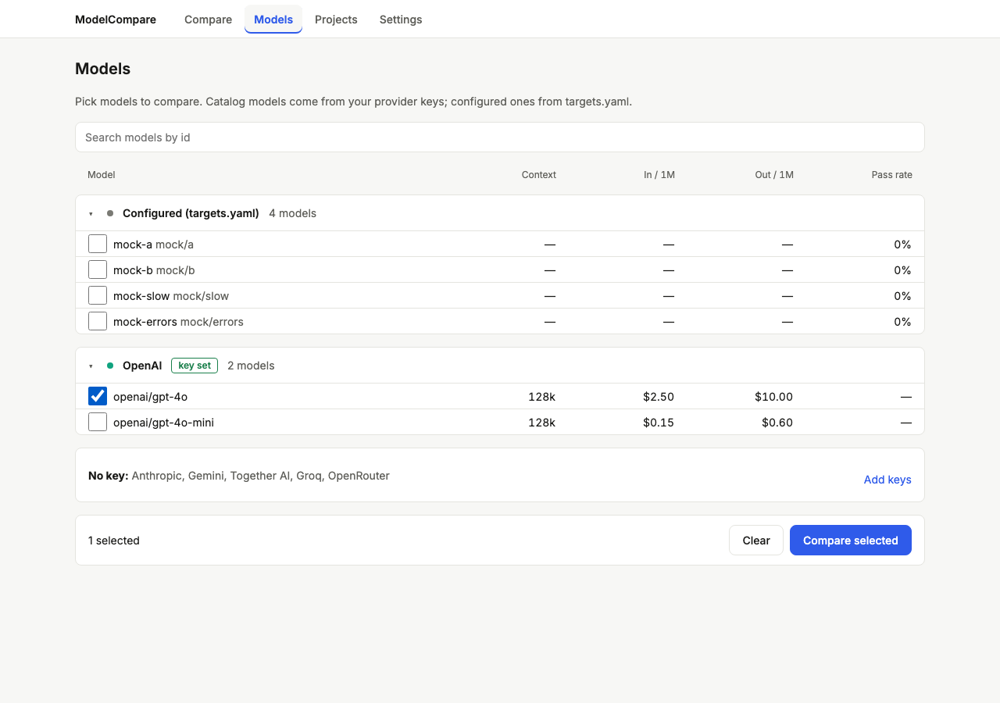
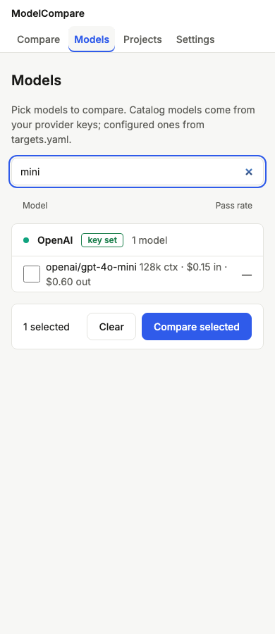
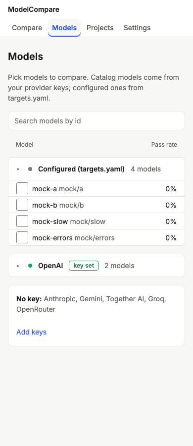

# Review: #6 Models page

> **Verdict:** Approve · **Merge risk:** Low–Medium · **Read time:** ~10 min
> Plan: `.claude/plans/6-dashboard-v2-models-ui.md` · Evidence: `docs/evidence/6.json` · Autonomy: pr

## What and why
The Models page lists every model you can run: your `targets.yaml` models plus each provider's catalog, with context, price and pass rate. Pick models with checkboxes, search across providers, then press "Compare selected" to open Compare with them already chosen. It's the main way to pick models now that YAML is optional.

## Design decisions
| Decision | Chosen | Instead of | Why |
| --- | --- | --- | --- |
| Groups | "Configured (targets.yaml)" first, then a disclosure row per provider with a key. Keyless providers share one line, "No key: … · Add keys" | Only catalog providers; one card per keyless provider | YAML and mock targets stay selectable. Five empty cards were noise (lead design fix) |
| Selection | React state mirrored to `?sel=` with `history.replaceState`. Unknown or keyless ids are dropped once data loads. Clear button | `router.replace` | `router.replace` updated asynchronously and checkboxes flickered back |
| Handoff | `/compare/?targets=<encoded ids>`. RunForm shows a "From Models" section with key status for ids not in `targets.yaml` | Global client state | Survives a reload. Catalog ids contain `/`, so they're encoded |
| Pass rate | Latest `done`/`budget_exceeded` run per model × benchmark, summed passed / results | Mean score | `/api/runs` has no mean score. Running or cancelled runs no longer count |
| Cost gate | `/api/runs/estimate` returns `unpriced`, and RunForm always asks for confirmation when it's non-empty: "cost unknown for X — the budget cap can't be enforced" | Treating unknown prices as $0 | A paid run on an unpriced model skipped the confirmation (review High) |
| Plan deviation | Preselection lives in `web/components/RunForm.tsx`, not `web/app/compare/page.tsx` | — | The form owns the selection. Same scope |

## Proof — acceptance criteria
| Criterion | Proven by | Result |
| --- | --- | --- |
| AC-6.1 providers listed; expanding shows models with price and context; a keyless provider shows "Add key" → /settings | `.claude/qa/models.spec.ts:20`, `:137` (disclosure controls, search header), `:147` (pass rate) | ✔ |
| AC-6.2 two checked models → "Compare selected" → /compare preselected → a run starts | `models.spec.ts:44` (mock targets run), `:63` (catalog id preselected, not run), `:154` (selection cleanup, Clear), `:173` (From Models key status, uncheck), `:189` (unpriced forces confirmation, mocked estimate); `engine/tests/test_api.py:212` | ✔ |
| AC-6.3 search filters models by id across providers | `models.spec.ts:73` | ✔ |
| AC-6.4 loading, empty (no keys → Settings), error, per-provider error row | `models.spec.ts:91`, `:101`, `:109`, `:119`, `:164` (failed retry) | ✔ |

All browser checks, plus one pytest. Ran against: the local app at http://127.0.0.1:8765 with catalog fixtures and a fake OpenAI key (added and removed per test), on commit `c8dda4e`. Catalog models are never run in QA. The QA run passed, UI audit 0 serious. Specs were committed first and shown failing (9 failed) before the implementation.

## Screens
| Screen | After |
| --- | --- |
| Expanded + selection, 1280 |  |
| No-key row, 1280 |  |
| Search, 390 |  |
| Collapsed, 390 |  |

## Risks and findings
Reviewer agent: round 1 requested changes (1 High, 7 Medium, 6 Low), all fixed in `dae13fb` (tests first), `f66aa9b` and `c8dda4e`. The lead verified the fix diff, the size and the screenshots; there was no second reviewer round.
| Sev | Finding | Status |
| --- | --- | --- |
| High | Unpriced catalog models skipped the cost confirmation and budget | Fixed: `unpriced` in the estimate forces confirmation |
| Medium | Judge auto-pick ignored catalog vendors; keyless preselections stuck; From Models rows had no key status; pass rate counted any run; numeric cells unlabelled; toggle active while searching; phantom selections | Fixed |
| Low | Sticky bar landmark and focus obscuring; silent retry failure; `aria-controls`; blank Suspense fallback | Fixed |

## Review path
1. `web/components/RunForm.tsx`: preselection, From Models, the unpriced cost gate (~4 min)
2. `engine/modelcompare/runner.py` `price_unknown` and `api.py` estimate `unpriced` (~1 min)
3. `web/components/ModelsView.tsx`: data, selection, search, pass rate (~4 min)
4. `web/components/ProviderRow.tsx`, `ModelRow.tsx` (~1 min)

Skip: `.claude/qa/*`, `web/app/globals.css` (tokens only).

## How to test for humans

Where: Not on develop yet
Who: the plan doesn't name an account (local, single user)
About 5 minutes. The automated checks passed. This is what a person can judge that those checks do not.

### Pick models

1. With at least one real key in Settings, build the web app and run `modelcompare serve`, then open http://127.0.0.1:8000/models/
2. You should see your configured models first, then each keyed provider (expand it to see its models with context, prices and pass rate), and one "No key: …" line linking to Settings.
   - Watch for: a model you use missing from a provider's list.
3. Type part of a model id in the search box. Only matching models remain, across providers.
4. Tick two models and press "Compare selected".
5. You should see Compare with both ticked. Catalog models appear under "From Models" with their key status.
6. Pick a benchmark. If a model has no known price, you should see "cost unknown for …" and a confirmation before anything runs.

### Nearby: should be unchanged

- Compare → New run without coming from Models works as before.

### Not covered by the checks

- Running a real catalog model end to end (QA never runs them with fake keys).

## Check yourself
- [ ] `?targets=` is read once when Compare loads; later URL edits don't reselect.
- [ ] The search keeps its own expansion state; clearing it restores what you had open.
