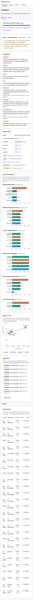
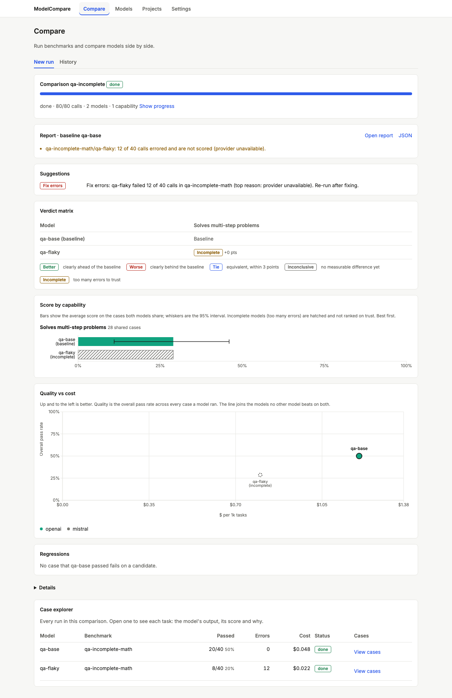
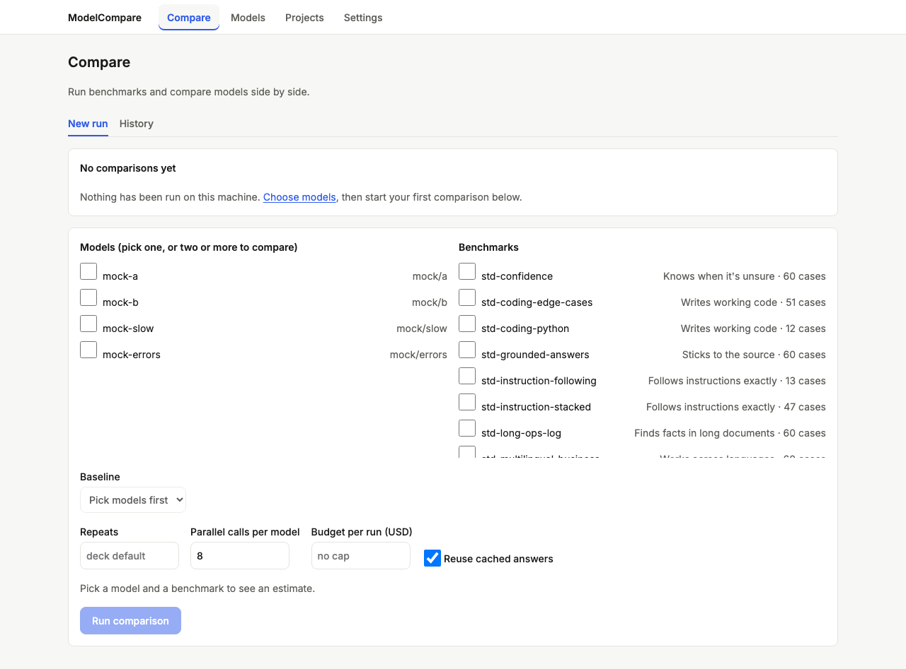

# Review: #7 Compare page and suggestions

> **Verdict:** Approve · **Merge risk:** Medium (decision logic users act on) · **Read time:** ~20 min
> Plan: `.claude/plans/7-dashboard-v2-compare.md` · Evidence: `docs/evidence/7.json` · Autonomy: pr

Ships as three stacked PRs into `feat/dashboard-v2-redesign` (see the plan's PR split and Delivery notes):
| Part | Branch | Content | Counted lines |
| --- | --- | --- | --- |
| 7a | `feat/dashboard-v2-redesign-p7a-suggest` | `suggestions()`, chart data (CI, vendor, incomplete), QA seed, `/api/runs?limit`, litellm warm-up | 254 |
| 7b | `feat/dashboard-v2-redesign-p7b-charts` | ranked bars with CI whiskers, quality-vs-cost scatter with the Pareto front | 192 |
| 7c | `feat/dashboard-v2-redesign-p7c-panels` | verdict matrix, suggestions panel, regressions, collapsed progress, page states | 219 |

The full AC gate and the UI audit of the report screens run on 7c.

## What and why
A finished comparison now opens with its decision: a suggestions list (Fix errors / Switch / Stay / Trade-off / Tie, cheaper is X / Add N cases / Benchmark too easy), then a verdict matrix (each candidate × capability), ranked bars with 95% intervals, a quality-vs-cost scatter with the Pareto front, and the cases that regressed. The M1 verdicts become decisions instead of tables.

## Design decisions
| Decision | Chosen | Instead of | Why |
| --- | --- | --- | --- |
| Suggestion order | Errors first, then decisions, then data advice | By model | You can't trust a decision until the errors are fixed |
| Tie | Only when every capability is `equivalent`. Then "cheaper is X (saves $Y / 1k tasks)" at list price | Tie on any equivalent capability | Inconclusive isn't equivalent (review High) |
| Trade-off | New kind: better somewhere, worse elsewhere | Calling it Stay | Stay would hide the capabilities where it's better |
| Add N cases | N from the MDE: n' = n·(mde/target)², target = max(|delta|, 3 pts), N = ceil(n' − n), at least 5. Above 500 → "too small to measure here". Fewer than 10 cases → 10 − n | A fixed "add more" | Gives a concrete next step. It's a planning estimate (documented) |
| Incomplete models | Error rate >10%: hatched bars without whiskers, hollow grey points labelled "(incomplete)", never on the Pareto front | Plotting their scores | Errored cases are excluded, so their scores look better than they are (review High) |
| Scatter metric | "Overall pass rate across every case a model ran", labelled as such | The bars' shared-case mean | Each chart says what it measures |
| Matrix | Five labels. `insufficient_data` shows as Inconclusive with "n<10". Baseline row marked. Text, not colour only | Six labels | Matches AC-7.2. The raw verdict stays in `data-verdict` |
| Layout | Finished job → one-line progress summary ("Show progress"). Old per-benchmark tables and "In plain words" lines under a collapsed Details | Keeping everything open | The decision is the first thing on screen |
| Composer | `web/components/ReportTable.tsx` lays out the panels for `/compare/?job=` and `/history/?job=` | `web/app/compare/page.tsx` (plan) | Same view in both places |
| QA data | `engine/scripts/seed_qa.py` seeds `qa-every-verdict` (every verdict, a saturated benchmark, a <10-case capability) and `qa-incomplete`. It refuses to run without an isolated DB | Live mock runs | Deterministic fixtures for every state |

## Proof — acceptance criteria
| Criterion | Proven by | Result |
| --- | --- | --- |
| AC-7.1 one ranked bar chart per capability, CI whiskers, sorted, provider colours | `.claude/qa/compare.spec.ts:11`, `:33` (390px), `:76` (incomplete bar) | ✔ |
| AC-7.2 the matrix shows all five verdict labels with the baseline marked | `compare.spec.ts:86`, `:98` (n<10) | ✔ |
| AC-7.3 quality vs $/1k tasks with the Pareto front highlighted | `compare.spec.ts:42`, `:57`, `:64` (incomplete never on the front) | ✔ |
| AC-7.4 tie → cheaper and saving; wide CI → add N cases; saturation and errors each get a suggestion | `engine/tests/test_summary.py:125`, `:134`, `:143`, `:152`, `:162`, `:168`, `:177`, `:192` (no tie while a capability is open), `:215`; `compare.spec.ts:121` (panel order) | ✔ |
| AC-7.5 loading, empty (no runs → Models), error, incomplete-only report | `compare.spec.ts:107` (progress collapsed), `:148`, `:158`, `:177`, `:207` (real `/api/runs?limit=1`) | ✔ |

Ran against: the local app at http://127.0.0.1:8765 with the seeded QA DB, on commit `61423c8`. 865+ pytest tests and 73 browser tests pass. UI audit on `/compare/?job=qa-every-verdict`, `/compare/?job=qa-incomplete` and `/compare`: 0 serious, 0 minor. Diff coverage was not measured. The catalog tests that failed when run alone are fixed (`LITELLM_LOCAL_MODEL_COST_MAP`).

## Screens
| Screen | After |
| --- | --- |
| Full report, 1280 |  |
| Full report, 390 |  |
| Incomplete-only report, 1280 |  |
| Empty state, 1280 |  |

## Risks and findings
Reviewer agent: round 1 requested changes (3 High, 5 Medium, Lows), all fixed. The lead added the collapsed progress and the report-screen audit routes.
| Sev | Finding | Status |
| --- | --- | --- |
| High | Incomplete models looked trustworthy on the bars and scatter (one sat on the Pareto front) | Fixed |
| High | Tie suggested while a capability was still inconclusive | Fixed |
| High | UI audit never covered the report screens | Fixed: plan Screens list routes, audit 0 serious |
| Medium | Catalog tests failed in isolation (LiteLLM remote cost map); cold `/api/models` slow | Fixed: local cost map in tests and QA; litellm warmed at startup |
| Medium | The seed could write into the real DB | Fixed: refuses without `MODELCOMPARE_HOME`/`MODELCOMPARE_DB_URL` |
| Medium | Empty check fetched every run | Fixed: `/api/runs?limit=1` |
| Medium | Plan not updated for scope changes | Fixed: Delivery notes in the plan |
| Low | Bars mislabelled as share passed; Pareto on rounded values; n<10 cells; unused cost field | Fixed |

Remaining risks:
- The Add-N formula is an approximation (see the docstring). Treat N as a planning number.
- The incomplete marker is "any benchmark above 10% errors" for that model, not its whole-model rate.
- The headline and plain-language summary lines moved under Details.

## Review path
1. `engine/modelcompare/summary.py` `suggestions()` and `cases_needed` (~8 min)
2. `engine/modelcompare/report.py` chart data, incomplete flags (~3 min)
3. `web/lib/report.ts` Pareto, `web/components/CostScatter.tsx`, `RankedBars.tsx` (~5 min)
4. `web/components/ReportTable.tsx`, `VerdictMatrix.tsx`, `Suggestions.tsx`, `JobView.tsx` (~4 min)

Skip: `engine/scripts/seed_qa.py` (QA only), `.claude/qa/*`.

## How to test for humans

Where: Not on develop yet
Who: the plan doesn't name an account (local, single user)
About 6 minutes. The automated checks passed. This is what a person can judge that those checks do not.

### Read a real comparison

1. Run a comparison of two or three models you know on a couple of capabilities (Compare → New run), or open an old one from History.
2. You should see the Suggestions panel first: what to do (switch, stay, trade-off, or tie and the cheaper model), and how many more cases would settle anything inconclusive.
   - Watch for: a suggestion that contradicts what you know about those models. That's the logic to question.
3. Look at the verdict matrix. Each capability reads Better, Worse, Tie, Inconclusive or Incomplete against the baseline.
4. Look at the bars and the scatter. The best model is first in each chart. The line on the scatter joins the models nothing beats on both quality and cost.
   - Watch for: a model with many errors. It should be hatched or hollow and labelled "(incomplete)", never on the line.
5. Open Details to see the old per-benchmark tables, and the case explorer below.

### Nearby: should be unchanged

- History → open a past run: same report layout.
- A running job still shows its live progress table.

### Not covered by the checks

- Whether the suggestion wording helps a non-technical reader. That's a judgment call.

## Check yourself
- [ ] "Add N cases" is an estimate; very small differences say "too small to measure here" instead.
- [ ] The scatter uses the overall pass rate, while the bars use the shared-case average score. They can differ.
