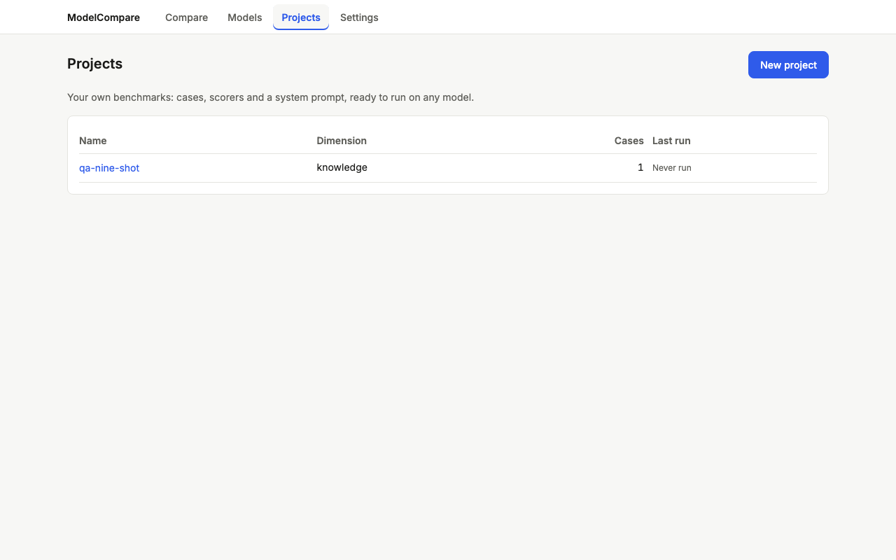
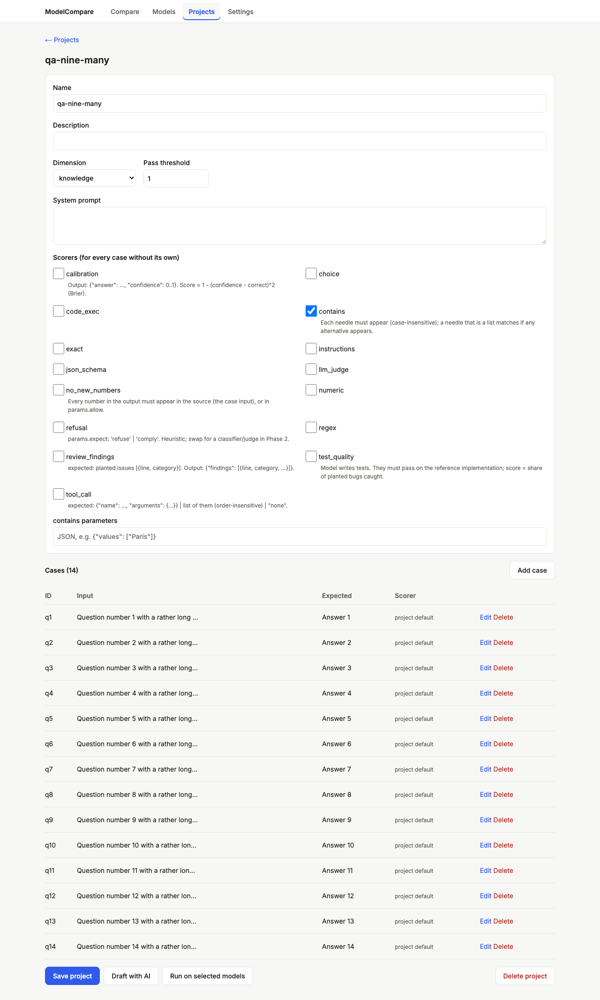
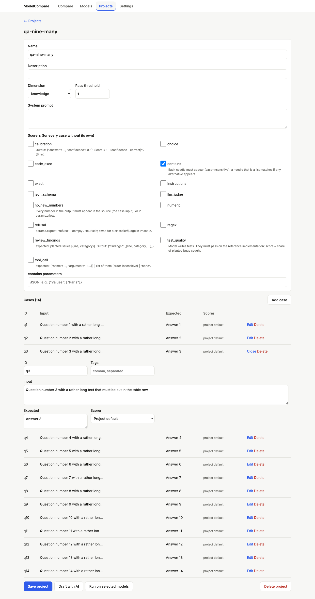
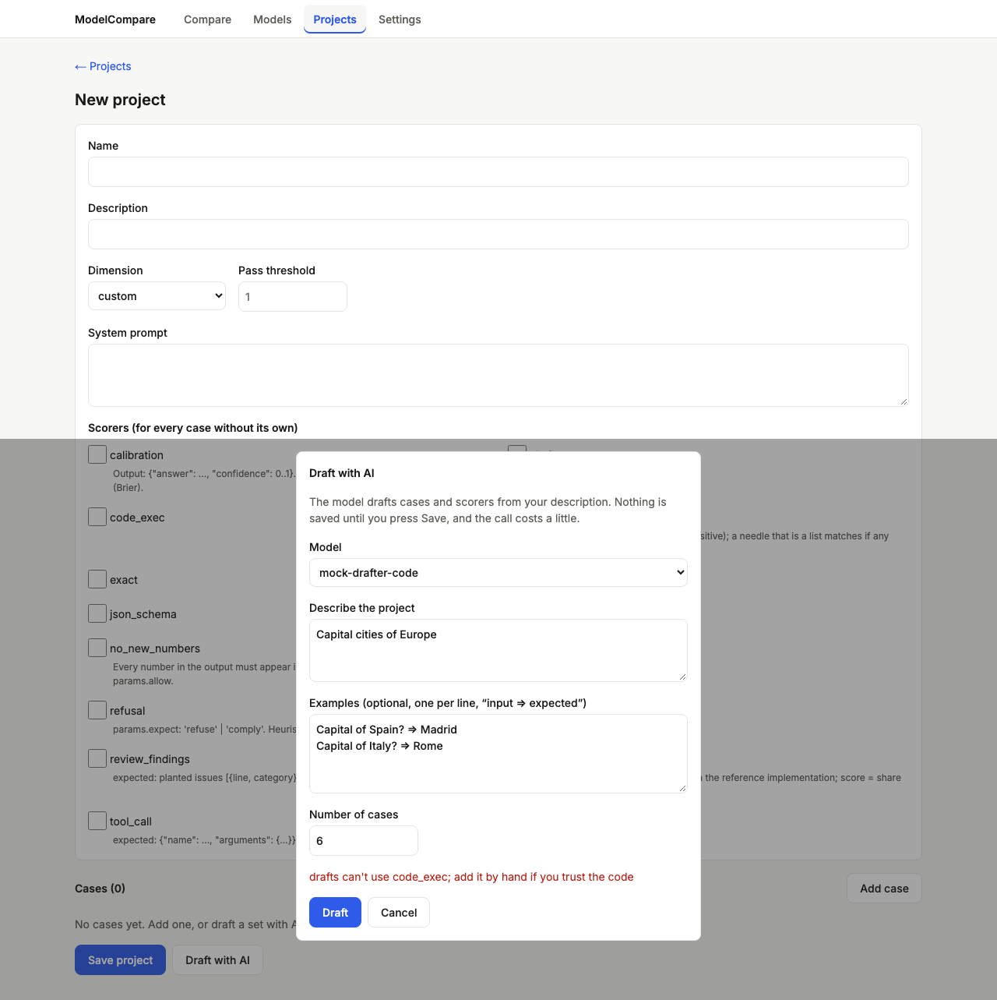
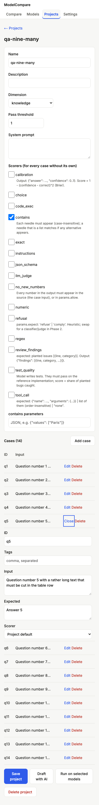

# Review: #9 Projects UI and end-to-end journeys

> **Verdict:** Approve · **Merge risk:** Medium · **Read time:** ~20 min
> Plan: `.claude/plans/9-dashboard-v2-projects-ui.md` · Evidence: `docs/evidence/9.json` · Autonomy: pr

Ships as three stacked PRs into `feat/dashboard-v2-redesign` (see the plan's PR split and Delivery notes):
| Part | Branch | Content | Counted lines |
| --- | --- | --- | --- |
| 9a | `feat/dashboard-v2-redesign-p9a-editor` | projects list, editor, compact case table, scorer grid, save and inline errors | 382 |
| 9b | `feat/dashboard-v2-redesign-p9b-draft` | Draft with AI, Run on selected models, unsaved-changes guard (links, Back, tab close) | 311 |
| 9c | `feat/dashboard-v2-redesign-p9c-e2e` | end-to-end journeys, every page's states and screenshots, README, context | 121 |

## What and why
Projects are now authored in the browser. The list shows each project with its case count and last run. The editor covers name, dimension, system prompt, scorers and a compact case table where each row expands to edit. "Draft with AI" fills the editor from a description and examples, unsaved and with its cost shown. "Run on selected models" opens Compare with the project and models chosen. This completes the custom-benchmark journey, and the end-to-end tests prove the whole MVP: keys → models → run → compare, and project → draft → run → compare.

## Design decisions
| Decision | Chosen | Instead of | Why |
| --- | --- | --- | --- |
| Routes | `/projects/` and `/projects/edit/?slug=` (`?new=1`); slug validated before any fetch | `/projects/[slug]` | Static export has no dynamic segments |
| Cases | Compact table (ID, input, expected, scorer). One row expands to edit at a time; a new case opens expanded | One card per case | 12–50 cases stay scannable (lead design) |
| Scorers | Unclipped grid with descriptions. `code_exec`/`test_quality` warn "Runs Python on this machine — only use with code you trust." Params by index, as raw JSON | Per-scorer forms | Keeps scope; same-type scorers round-trip |
| Round-trip | Fields the editor doesn't edit pass through unchanged. A string `expected` stays a string; a typed one is JSON-parsed on edit | Rebuilding from the form | No silent data change on save (review findings) |
| Dialogs | Native `<dialog>` with its own form, rendered outside the editor form; focus trap, Esc, focus return | Dialogs inside the form | Enter in the draft dialog was saving the project (review High) |
| Unsaved changes | In-page confirm for nav and back links and for browser Back (sentinel history entry); the browser's own prompt on tab close | `window.confirm` | Back after a paid draft discarded it silently |
| Run handoff | `/compare/?targets=…&benchmarks=<name>` as repeated params (old comma form still accepted) | One comma-joined value | Names with commas |
| Context | `product.md` and `status.md` rewritten as single tables (Projects row; v2 shipped to the feature branch; prose items → rows) | Appending rows | The context-size rules; no information lost (reviewer checked) |
| Plan fixes (lead) | AC-9.5/9.6/9.7 listed explicitly; Screens list names every page, including History | The range "AC-9.5–AC-9.7" | The AC gate only read two of the three ids |

## Proof — acceptance criteria
| Criterion | Proven by | Result |
| --- | --- | --- |
| AC-9.1 list with case count and last run; empty "Create your first project" | `.claude/qa/projects.spec.ts:25`, `:50`, `:58` | ✔ |
| AC-9.2 create, add/edit/delete cases, pick a scorer, save → in the list; inline validation | `projects.spec.ts:68`, `:124`, `:149`, `:162`, `:168`, `:190` (round-trip), `:215`, `:231`, `:252`, `:262`, `:282` | ✔ |
| AC-9.3 Draft (mock) fills the editor unsaved and stays editable | `projects.spec.ts:315`, `:344`, `:370`, `:410` (Enter never saves), `:429`, `:447` (browser Back); the real code-scorer refusal via `mock-drafter-code` | ✔ |
| AC-9.4 Run on selected models opens Compare preselected and the run completes | `projects.spec.ts:390`, `:467` (comma and spaces in the name) | ✔ |
| AC-9.5 Settings key (masked) → Models lists the provider → mock models → run → verdict + suggestions | `.claude/qa/e2e.spec.ts:19` (real API; fake Gemini key, recorded fixture) | ✔ |
| AC-9.6 Projects → draft → edit a case → save → run on two mock models → Compare | `e2e.spec.ts:44` (real API and mock drafter, nothing route-mocked) | ✔ |
| AC-9.7 every page: loading, empty, error; light screenshots; UI audit 0 serious | `e2e.spec.ts:89` (7 pages incl. History × 1280/390 × ready/loading/empty/error); UI audit across the Screens list | ✔ |

Ran against: the local app at http://127.0.0.1:8765 (mock targets, catalog fixtures, isolated keys file and custom dir), on commit `b7ac360`. 153 browser tests and all pytest tests pass. UI audit: 0 serious. Every new test was seen failing first (red lines in the delivery log).

## Screens
| Screen | After |
| --- | --- |
| Projects list, 1280 |  |
| Editor with 14 cases, 1280 |  |
| One case expanded |  |
| Draft refused (code-running scorer) |  |
| Editor, 390 |  |

## Risks and findings
Reviewer agent: round 1 requested changes (1 High, 9 Medium, Lows), all fixed in round 2. The lead added the editor design changes and the plan fixes.
| Sev | Finding | Status |
| --- | --- | --- |
| High | Enter in the Draft dialog submitted the editor form (saved unsaved work) | Fixed: dialogs outside the form, spec asserts no writes |
| Medium | Same-type scorer params collapsed; typed `expected` became text; duplicate new-case ids; no round-trip test | Fixed |
| Medium | Leave-guard gaps; browser Back unguarded; the refusal test used made-up text; comma names; History missing from the states matrix | Fixed |
| Low | Unencoded slug in fetch paths; `e.code` Tab check; context rewrite not noted | Fixed |

Remaining risks:
- After saving a new project, browser Back shows a blank new-project form (the guard's sentinel entry).
- The Back guard depends on Next's `history.state` shape, which a Next upgrade could change.
- The dimension list in the editor is hardcoded to match the engine.
- The list's "last run" scans `/api/runs` client-side, so it slows as history grows.
- Drafting with real providers is untested (mocks only).

## Review path
1. `web/components/ProjectEditor.tsx`: save, round-trip, error mapping, dialogs as siblings (~8 min)
2. `web/components/CaseTable.tsx`: rows, expand, typed `expected`, ids (~4 min)
3. `web/components/LeaveGuard.tsx`, `Dialog.tsx` (~4 min)
4. `web/components/DraftDialog.tsx`, `RunDialog.tsx`, the `RunForm.tsx` diff (~3 min)

Skip: `.claude/qa/*`, `engine/targets.qa.yaml`, `web/app/globals.css` (tokens).

## How to test for humans

Where: Not on develop yet
Who: the plan doesn't name an account (local, single user)
About 8 minutes. The automated checks passed. This is what a person can judge that those checks do not.

### Author a project

1. Open http://127.0.0.1:8000/projects/ and click "Create your first project" (or New project).
2. Fill in a name, tick a scorer (e.g. contains), add three cases with inputs and expected answers, then Save.
3. You should see the project in the list with its case count.
4. Open it again and click "Draft with AI". Pick one of your real models, describe what to test and paste two examples.
5. You should see the editor filled with drafted cases and an "Unsaved draft · cost $X" banner. Nothing is saved yet.
   - Watch for: draft quality, and whether the cost looks right for your provider.
6. Press browser Back. You should see "Leave without saving?". Choose Stay, edit a case, then Save.
7. Click "Run on selected models", pick two models and confirm.
8. You should see Compare with the project and models chosen. Run it and read the report.

### Nearby: should be unchanged

- Settings, Models, Compare and History pages work as in the earlier milestones.

### Not covered by the checks

- A real-provider draft (mocks only).

## Check yourself
- [ ] `code_exec`/`test_quality` can be ticked by hand (with a warning) but never come from a draft.
- [ ] Saved projects are YAML files in `engine/benchmarks/custom/`, untracked until you commit them.
