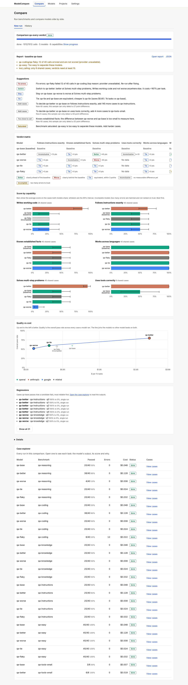
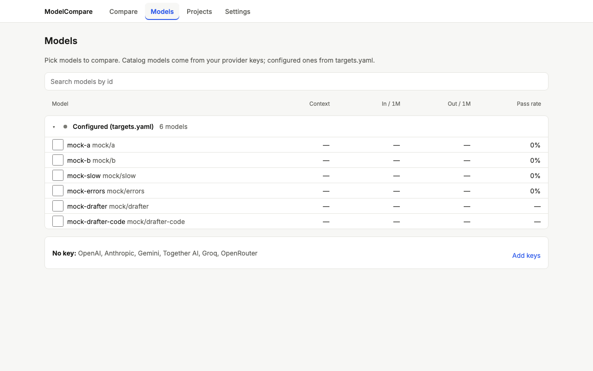
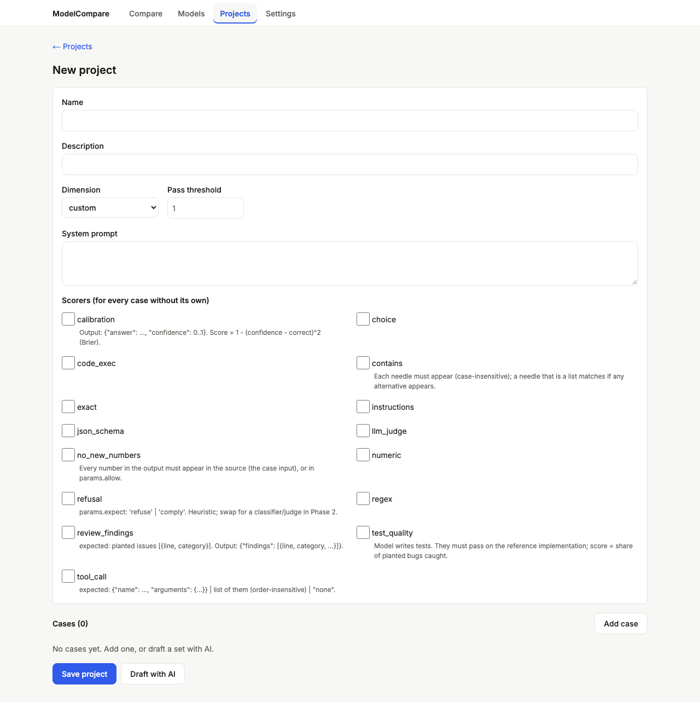
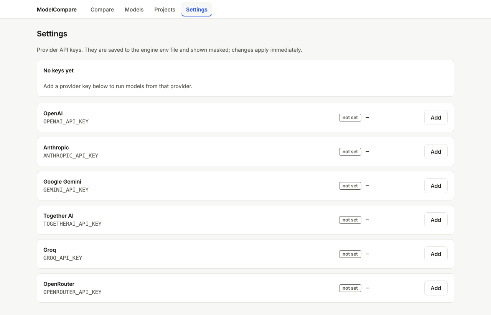
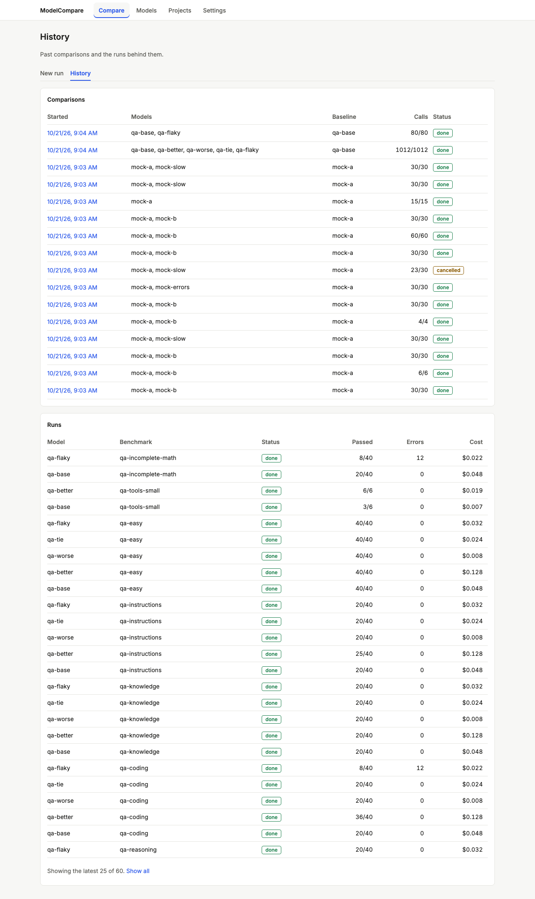

# Review: Dashboard v2 (MVP feature release)

> **Verdict:** Approve · **Merge risk:** Medium–High (new UI stack, writes keys and benchmark files from HTTP, score semantics change) · **Read time:** ~25 min
> Plan: `.claude/plans/mvp-dashboard-v2.md` (+ milestone plans 1–9) · Evidence: `docs/evidence/1.json` … `docs/evidence/9.json` · Autonomy: pr

## What and why
From one local URL (`modelcompare serve`) you can now add provider keys, pick any chat model your keys can reach, build a custom project benchmark (with an AI draft), run it, and get a clear decision: Better / Worse / Tie (and the cheaper pick) / Incomplete / "add N cases". Before, keys lived only in the env file, models had to be typed into `targets.yaml`, there was no way to author benchmarks, and most comparisons ended in "No measurable difference", partly because provider errors were scored as 0.

## Milestones
Each milestone PR was built, tested against the running app, reviewed, and merged into `feat/dashboard-v2-redesign`. Milestones over 400 lines shipped as stacked PRs.
| # | Milestone | PRs | Review |
| --- | --- | --- | --- |
| 1 | Trustworthy scores: errors excluded, `equivalent`/`incomplete`, saturation flag, temperature fallback | #11 | `docs/reviews/1.md` |
| 2 | Next.js shell, design tokens, `/api` prefix, served by FastAPI | #12 | `docs/reviews/2.md` |
| 3 | Run → report → history ported with full parity; old page deleted | #13, #17, #18 | `docs/reviews/3.md` |
| 4 | Settings: provider keys (masked, localhost-only, written to the env file) | #19, #20 | `docs/reviews/4.md` |
| 5 | Model catalog API: per-key model lists, cached, runnable without YAML | #21 | `docs/reviews/5.md` |
| 6 | Models page: provider tree, search, selection → Compare | #22 | `docs/reviews/6.md` |
| 7 | Compare report: suggestions, verdict matrix, ranked bars, cost scatter + Pareto | #23, #24, #25 | `docs/reviews/7.md` |
| 8 | Projects API + AI draft | #26 | `docs/reviews/8.md` |
| 9 | Projects UI + end-to-end journeys | #27, #28, #29 | `docs/reviews/9.md` |

#14 and #16 closed automatically when their stacked base branches were deleted at merge. Their content landed unchanged via #17 and #18 (#15 had merged into #14's branch).

## Key design decisions (whole feature)
| Decision | Chosen | Why | Detail |
| --- | --- | --- | --- |
| Scores | Errored calls are excluded and counted. >10% errors → `incomplete`. Ties use a TOST-style test (90% CI within ±3 pts) | Errors scored as 0 produced fake differences | #1 |
| UI | Next.js static export served by FastAPI at one URL. API under `/api` with old-path aliases | One process; typed pages | ADR `2026-10-19-nextjs-static-export.md` |
| Keys | Written to the engine env file (temp file, mode 600, atomic). Shown masked only. Strict Host + Origin checks on settings, models and projects routes | The CLI already reads that file | ADR `2026-10-19-keys-in-env-file.md`, #4 |
| Models | Live per-key catalog, chat-only, 10-minute cache, `<provider>/<id>` runnable without YAML. Unknown prices force the cost confirmation | YAML went stale | #5, #6 |
| Decisions | Suggestions ordered errors → decisions → data advice. Incomplete models never ranked on the Pareto front | Turns verdicts into actions | #7 |
| Projects | YAML in `benchmarks/custom/`. AI drafts never use code-running scorers (`code_exec`, `test_quality`); pasted text is fenced as data | Drafts are untrusted; those scorers run Python locally | #8, #9 |

## Proof — end-to-end acceptance (MVP)
| Criterion | Proven by | Result |
| --- | --- | --- |
| AC-9.5 Settings → fake key → masked → Models lists the provider (recorded fixture) → mock models → run → verdict + suggestions | `.claude/qa/e2e.spec.ts:19` (real API) | ✔ |
| AC-9.6 Projects → describe + examples → Draft (mock) → edit a case → save → run on two mock models → Compare | `.claude/qa/e2e.spec.ts:44` (real API) | ✔ |
| AC-9.7 every page shows loading, empty and error states; light screenshots; UI audit 0 serious | `.claude/qa/e2e.spec.ts:89` (7 pages × 1280/390 × 4 states); UI audit below | ✔ |

Whole-feature QA on `feat/dashboard-v2-redesign` at `d9f5eb1`, from a fresh QA data directory: 893 pytest tests and 153 browser tests pass, web lint and build pass, API smoke passes. UI audit across `/`, `/compare/`, the full report, the incomplete report, `/history/`, `/models/`, `/projects/`, the project editor and `/settings/` (5 viewports each, 45 screenshots): 0 serious. The 4 minor findings are false positives on visually-hidden screen-reader labels on Models. Every acceptance criterion in plans 1–9 has a tagged test that passes. Diff coverage was not measured (no coverage command configured).

## Screens
| Screen | After |
| --- | --- |
| Compare report, 1280 |  |
| Compare report, 390 |  |
| Models |  |
| Project editor |  |
| Settings |  |
| History |  |

## Risks and open follow-ups
- **Security follow-up (recommended before relying on it):** run, compare and history routes under `/api` don't have the localhost Host/Origin check that settings, models and projects have. A DNS-rebinding page could start paid runs with your keys. Fix by applying the same dependency to every mutating `/api` route.
- **`RunRequest` has no bounds:** `concurrency: 0` from a non-UI client hangs a job. The UI enforces minimums.
- **Score semantics changed (intended):** historical reports re-render with different numbers.
- **Untested against live providers:** catalog response shapes, the key Test button, draft `response_format`/`finish_reason`. All covered with fakes and fixtures only.
- **Packaging:** `web/out` isn't in the Python package, so a non-editable install shows a 503 until you run `npm run build` in a checkout (or set `MODELCOMPARE_WEB_OUT`).
- **Context:** `docs/context/architecture.md` and `domain.md` still fail the context-size check. This predates the feature; `product.md` and `status.md` now pass.
- **Process notes (proposed, not applied):** add `**/test_*.py`/`**/tests/**` to the global PR-size ignore; let a PR-split row declare its criteria in `ac-coverage`; fail the AC gate on a red bridge test; add `pgrep -fl`/`ps eww` to the secret guard; default `LITELLM_MODE=PRODUCTION` in QA for Python LLM projects.

## Review path
Read in this order, riskiest first (each milestone review has its own path):
1. `engine/modelcompare/keys.py` and the settings router in `engine/modelcompare/api.py` (#4) (~10 min)
2. `engine/modelcompare/projects.py`: path guard and draft safety (#8) (~8 min)
3. `engine/modelcompare/report.py`, `stats.py`, `summary.py`: score semantics and suggestions (#1, #7) (~10 min)
4. `engine/modelcompare/catalog.py` and `schema.resolve_target` (#5) (~5 min)
5. `web/components/RunForm.tsx`: cost gate and preselection (#3, #6) (~4 min)

Skip: `web/package-lock.json`, `.claude/qa/*`, `engine/tests/fixtures/*`, `docs/reviews/*/` images.

## How to test for humans

Where: Not on develop yet (this PR targets `main`)
Who: the plan doesn't name an account (local, single user)
About 15 minutes. The automated checks passed. This is what a person can judge that those checks do not.

### Setup

1. `cd web && npm ci && npm run build`, then `cd engine && .venv/bin/modelcompare serve`, and open http://127.0.0.1:8000/

### Keys → models → compare

1. Open Settings and add a key for a provider you use. You should see only the masked form (`sk-…` plus the last 4). Click Test; it should say accepted.
2. Open Models. You should see that provider's chat models with prices and context. Tick two and press "Compare selected".
3. On Compare, pick a small benchmark. You should see an estimate and a cost confirmation before anything runs. Confirm.
4. When it finishes, you should see Suggestions first (switch / stay / tie and the cheaper model / add N cases), then the verdict matrix, bars and the cost scatter.
   - Watch for: a suggestion that contradicts what you know about those models.

### Projects

1. Open Projects → New project → "Draft with AI": pick a model, describe a task and paste two examples. You should see an unsaved draft with its cost.
2. Edit a case and Save. Press "Run on selected models" with two models. You should see Compare with the project preselected; run it.

### History

1. Open Compare → History. You should see past runs; open one to see the same report.

### Nearby: should be unchanged

- `modelcompare run …` from the CLI and its HTML report.
- API clients on the old paths (e.g. `/targets`) still get JSON.

### Not covered by the checks

- Live providers end to end (keys Test, catalog, drafts). The checks use mocks and recorded data.
- The DNS-rebinding exposure on run routes (follow-up above).

## Check yourself
- [ ] Decide on the `/api` Host/Origin hardening follow-up before using the dashboard alongside untrusted browsing.
- [ ] Saved projects in `engine/benchmarks/custom/` are untracked until you commit them.
